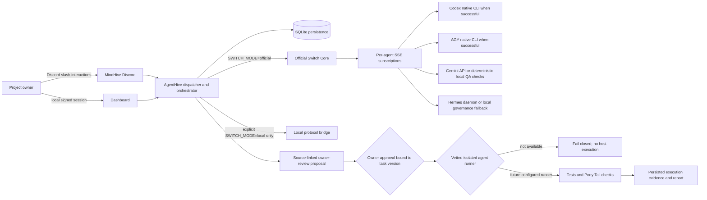

# AgentHive V2 — Architecture and Workflow

## System architecture



Official mode must connect all expected agents and confirm room participation before collaboration. It sends messages through Official Switch and requires incoming SSE evidence before persisting discussion turns. The local protocol bridge is an explicit test/development transport, not an Official Switch substitute.

## Workflow

```mermaid
sequenceDiagram
  actor Owner
  participant Discord as MindHive Discord
  participant Hive as AgentHive
  participant Switch as Official Switch
  participant Runtimes as Agent runtimes
  participant DB as Project database
  Owner->>Discord: /newproject
  Discord->>Hive: Registered application command
  Hive->>Switch: Register/subscribe and create project room
  Hive->>DB: Save project and PROJECT.md path
  Owner->>Discord: /analyse
  Discord->>Hive: Request independent runtime records
  Hive->>Runtimes: Invoke available runtime; record fallbacks honestly
  Hive->>DB: Save result and runtime evidence
  Owner->>Discord: /discuss
  Hive->>Switch: Send ordered room message
  Switch-->>Runtimes: Deliver SSE event IDs
  Hive->>DB: Persist message/event IDs in order
  Owner->>Discord: /assign
  Hive->>DB: Read the project's ordered discussion
  Hive-->>Owner: Source-linked task proposal; no consensus claim from fallback
  Owner->>Discord: /approve
  Discord->>DB: Record owner and task-version approval only
  Owner->>Discord: /report
  Hive-->>Owner: Execution blocked until isolated native-agent runner is implemented
```

## Component responsibilities

- **MindHive Discord:** registered application commands and owner-facing review. The bot must authenticate and sync commands at startup; this work did not restart the live gateway.
- **AgentHive:** command dispatch, owner checks, project workspace, analysis/discussion persistence, planning, and execution policy.
- **Official Switch:** shared registration, rooms, subscriptions, SSE event delivery, and cross-agent messages.
- **Codex and AGY:** native CLI identity is recorded only after a successful CLI response. Their unavailable paths do not submit invented project proposals.
- **Gemini:** live API when configured; current local fallback is a deterministic check for whether selected QA topics are explicitly present in the brief. It does not perform model reasoning or code review.
- **Hermes:** live daemon when available; current local fallback records coordinator status and prepares a generic work breakdown linked to actual persisted discussions. It does not claim independent analysis or consensus.
- **Dashboard:** backend-owned project state, protected by an HttpOnly signed owner session and CSRF checks.
- **Task runner:** not implemented for native agent execution. The test-runner container alone is not an agent sandbox; task execution stays blocked.

## Evidence and provenance

Analysis rows include runtime evidence. Discussion rows retain sender, ordered turn, Switch message ID, event ID, room association, and runtime evidence. Planning fails when project-specific discussion history is empty or unassociated. Approval stores the approving owner, timestamp, and task-version hash. Tests confirm these safeguards in an isolated SQLite test database.

Earlier live Official Switch evidence is retained in [AGENTHIVE_FINAL_EVIDENCE_SUMMARY.md](AGENTHIVE_FINAL_EVIDENCE_SUMMARY.md). Because the running backend has not loaded this worktree, treat that as historical evidence, not proof that the updated build is live.
