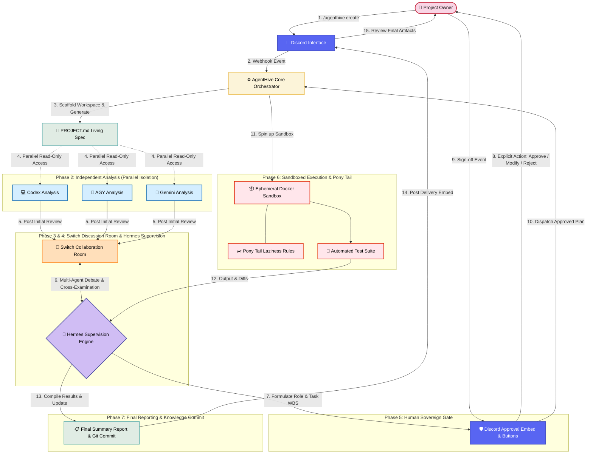
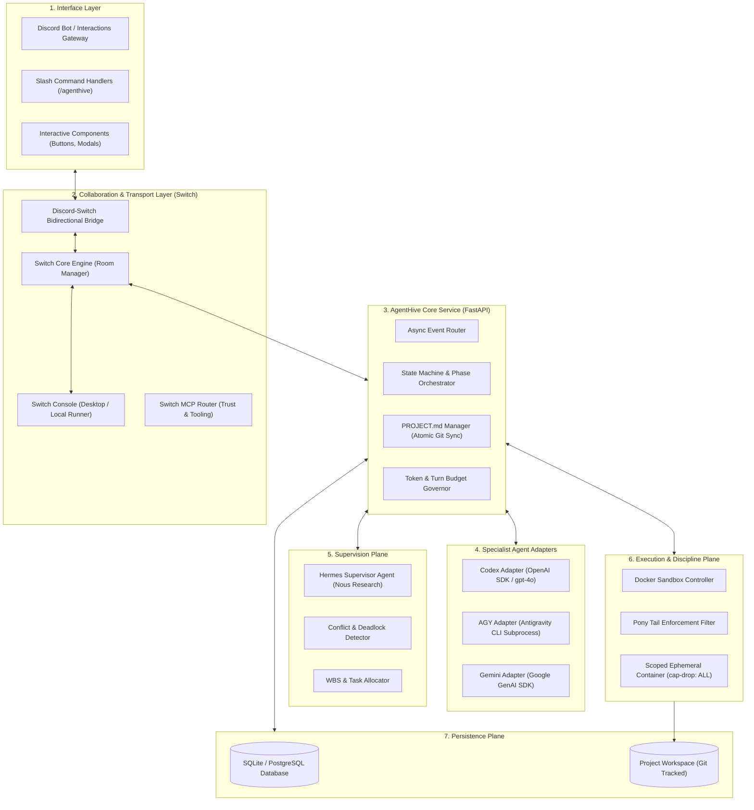
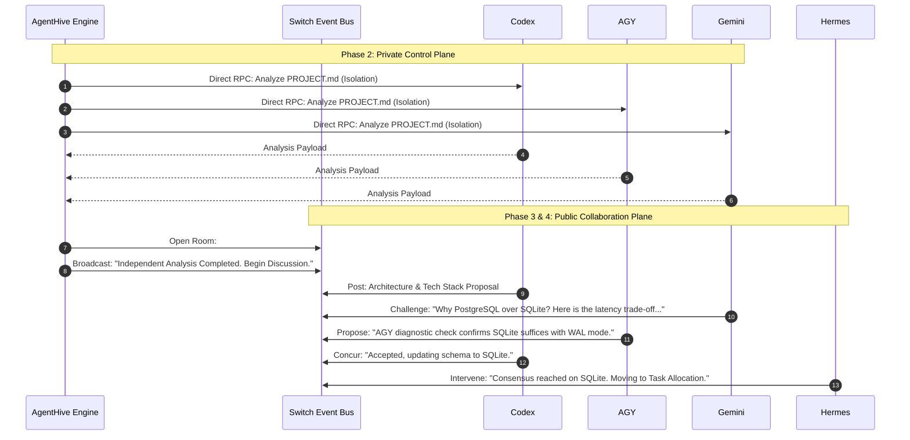
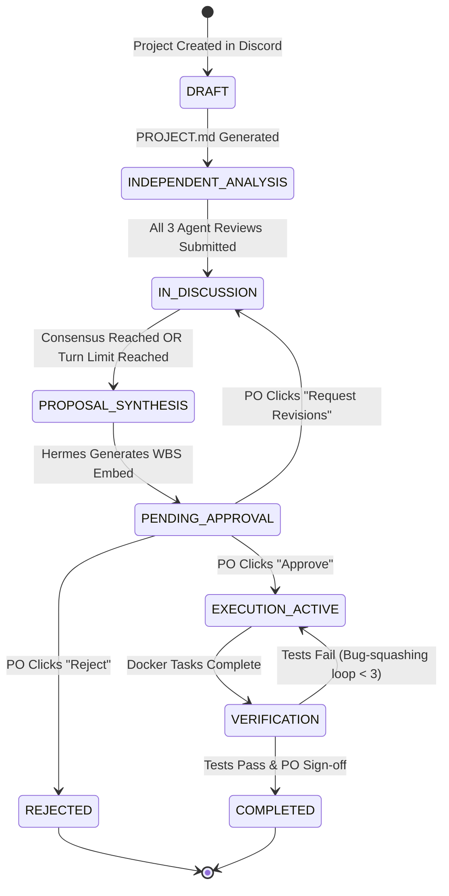
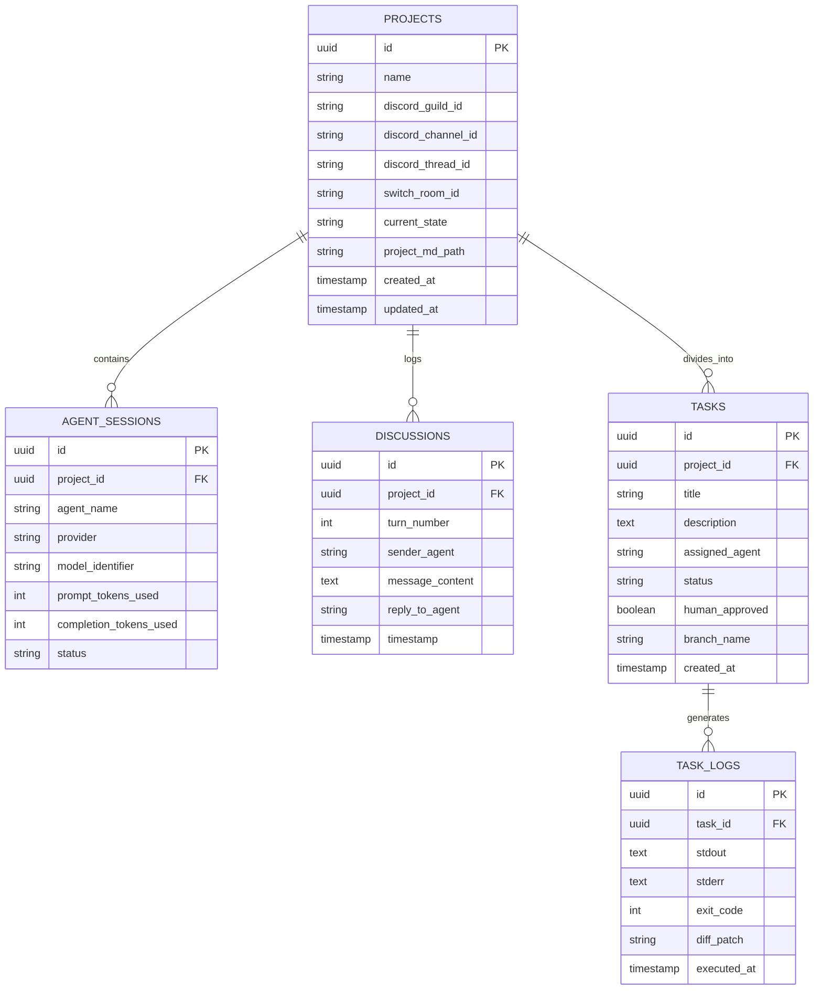

# AgentHive — System Architecture Specification (`ARCHITECTURE.md`)

This document outlines the complete architectural design of **AgentHive**, a multi-agent AI collaboration platform. It details how independently operating frontier AI models communicate, challenge proposals, distribute tasks, and execute development under the supervision of **Hermes** and the sovereign authority of the human **Project Owner**.

---

## 1. End-to-End Architectural Flow

The foundational flow of AgentHive progresses through eight strictly coordinated stages:

---

## 2. Overall System Architecture

AgentHive is designed around a decoupled, event-driven hexagonal architecture:

---

## 3. Component Responsibilities

### 3.1 Discord Interface Layer
- Ingests slash commands (`/agenthive create`, `/agenthive status`, `/agenthive approve`).
- Renders rich embeds showing live project status, agent proposals, debate summaries, and logs.
- Captures human inputs via buttons and modals (Human-in-the-Loop gate).
- Manages dedicated project threads to prevent chatter spillover.

### 3.2 Switch Collaboration Layer (`sandbox-quantum/switch`)
- Provides shared "Rooms" where agents and humans collaborate within a unified conversational history.
- Handles multi-agent routing, message queues, and distinct avatar/identity presentation.
- Interfaces with the local Switch Console for on-demand local session spinning.
- Exposes Model Context Protocol (MCP) servers for system metrics and tool invocations.

### 3.3 AgentHive Core Orchestrator (FastAPI)
- Drives the 8-phase workflow state machine.
- Manages asynchronous event streams between Switch, Discord, and model backends.
- Enforces token budgets and max conversation turns to eliminate infinite debate loops.
- Provides REST APIs and OpenAPI definitions for programmatic management.

### 3.4 Document Manager (`PROJECT.md`)
- Generates standardized project specifications from `PROJECT_TEMPLATE.md`.
- Maintains strict atomic writes and Git commit tracking on every specification change.
- Exposes read-only views to agents during the independent analysis phase.

### 3.5 Agent Adapter Pool
- **ChatGPT Codex Adapter:** Formulates architecture, schema models, and writes core backend code.
- **AGY Adapter:** Runs Antigravity CLI diagnostic tools, evaluates integration feasibility, and assists in terminal workflows.
- **Gemini Adapter:** Conducts deep research, cross-examines proposed stacks, and designs verification/test suites.

### 3.6 Hermes Supervisory Engine
- Moderates agent debates, flags logical contradictions, and terminates circular arguments.
- Synthesizes disparate proposals into a unified Work Breakdown Structure (WBS).
- Dynamically assigns tasks based on agent specialization.
- Escalates architectural forks or ambiguous requirements directly to the Project Owner.

### 3.7 Execution & Pony Tail Sandbox
- Executes approved code tasks inside isolated, ephemeral Docker containers.
- Implements Pony Tail rules to prune over-engineered abstractions and block unauthorized external packages.
- Executes automated test runners and returns structured diffs to Hermes.

### 3.8 Persistence Layer
- **SQLite / PostgreSQL:** Stores relational state, session IDs, turn counters, audit trails, and execution logs.
- **Workspace Filesystem:** Local disk repository containing code, test files, and `PROJECT.md`, tracked by Git.

---

## 4. Agent Communication Architecture

AgentHive separates communication into two distinct planes:
1. **Public Collaboration Plane (Switch Room):** An open, multi-agent channel where messages are broadcast to all participants (Codex, AGY, Gemini, Hermes, and human observers). This is mirrored into a Discord thread.
2. **Private Control Plane (AgentHive Internal Bus):** Asynchronous direct RPCs between the AgentHive Orchestrator and individual agent adapters (used for independent analysis, private health checks, and sandboxed code execution prompts).

---

## 5. Session & State Management

AgentHive models every project as a deterministic Finite State Machine (FSM). State transitions are governed by strict pre-conditions:

### State Storage Details:
- Every transition emits an event to the relational database (`projects` table).
- Project states are recoverable upon service restart: if the orchestrator restarts while in `IN_DISCUSSION`, it queries the Switch Room message history and resumes the session without losing context.

---

## 6. Database Schema Requirements

AgentHive utilizes a relational schema optimized for auditability, session recovery, and task tracking:

---

## 7. Error Handling, Fault Tolerance & Recovery

### 7.1 Agent Crash or Timeout
- **Detection:** Each adapter implements an exponential backoff with a hard timeout of 60 seconds per turn.
- **Recovery:** If an agent (e.g. Codex) fails to respond after 2 retries, Hermes receives a `ProviderDegraded` alert. Hermes can re-route the prompt to an alternate model (e.g. Gemini 1.5 Pro) or alert the Project Owner via Discord.

### 7.2 Infinite Debate Prevention (Turn & Token Governance)
- **Problem:** Agents may engage in endless philosophical debates without reaching an implementation consensus.
- **Mitigation:**
  1. **Hard Turn Cap:** Maximum 10 turns per discussion round.
  2. **Sentiment & Drift Heuristics:** Hermes monitors semantic similarity between rounds. If delta is < 5% across 2 consecutive rounds, Hermes forcibly locks the discussion and triggers synthesis.
  3. **Token Governor:** Hard cap of 100,000 tokens per discussion session.

### 7.3 Sandboxed Execution Failures
- **Compilation/Syntax Errors:** Captured by the Docker runner and returned to the responsible agent with the exact stderr output.
- **Bug-Squashing Loop Limit:** Maximum 3 automatic fix attempts. If tests still fail after 3 attempts, Hermes halts execution and posts a high-priority escalation embed to Discord with logs.
- **Host Protection:** Ephemeral containers have no access to host networks, environment secrets, or directories outside the designated `/workspace/output`.
