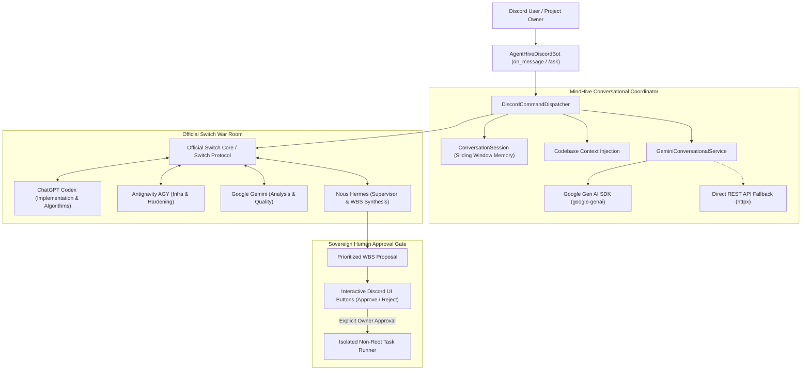

# Conversational AI & Engineering Manager Architecture

This document describes the design, implementation, persona principles, and Discord integration of MindHive's Conversational AI Engineering Manager powered by Google Gemini.

---

## 1. Role & Architectural Overview

MindHive acts as an autonomous **AI Engineering Manager**, not a generic chatbot. It receives requests from developers in Discord, interprets project goals, inspects codebases, coordinates a swarm of specialized AI agents (ChatGPT Codex, Antigravity AGY, Google Gemini, Nous Hermes) via the **Official Switch Protocol**, and synthesizes actionable Work Breakdown Structure (WBS) development workflows.

---

## 2. Engineering Manager Persona & Core Principles

The conversational engine is governed by a strict system instruction (`ENGINEERING_MANAGER_SYSTEM_PROMPT`):

1. **Persona:** Decisive, concise, rigorous, and technical. Speaks with the authority and brevity of a senior engineering manager.
2. **Codebase Understanding:** Cites real observed repository files, architecture patterns, entry points, dependencies, and test states. Distinguishes hard facts from inferred conclusions.
3. **Actionable Workflows:** Proposes prioritized, concrete engineering workflows with explicit acceptance criteria, agent assignments, and risk mitigation.
4. **Human-in-the-Loop Sovereign Gate:** Strictly enforces that **no code is executed without explicit human owner approval**.
5. **Honest Provenance:** Never hallucinates fake agent executions or fabricated consensus. Unavailable tools or offline models are reported plainly.
6. **Tone:** Direct, technical, and actionable. Avoids generic conversational filler, disclaimers, or excessive emojis.

---

## 3. Google Gemini Integration Architecture

### Dual-Layer Client Strategy
- **Primary:** Official `google-genai` SDK (version `1.47.0+`).
- **Resilient Fallback:** Direct HTTP/2 asynchronous REST API client via `httpx` using header-based authentication (`x-goog-api-key: ...`).
- **Configurable Model:** Configured via `GEMINI_CONVERSATIONAL_MODEL` (defaults to `gemini-2.5-flash`).

### Multi-Turn Session Memory
- Sessions are maintained per Discord channel/thread (`context_id`).
- Maintains a 20-turn sliding window to ensure token safety and context freshness without unbounded memory growth.
- Injects active repository metadata (`CodebaseInventory`) into the context window so follow-up queries reference real project files.

### Rate Limit & Error Handling
- Proactive detection of HTTP 429 rate limit responses with backoff and retry.
- Structured timeout handling (30s) prevents hanging Discord interactions.

### Deterministic Offline Mode
If `GEMINI_API_KEY` is unconfigured or network access is restricted, MindHive automatically switches to deterministic codebase explanations (`explain_codebase_deterministic`). It reports its offline status transparently without failing or faking LLM responses.

---

## 4. Discord Conversational Interface

### Natural Mentions (`on_message`)
Users can speak naturally to MindHive in any channel where the bot is present:
- `@AgentHive hello`
- `@AgentHive analyse https://github.com/owner/repo`
- `@AgentHive what does this project do?`
- `@AgentHive create a development plan`

### Safety & Deduplication Guards
1. **Bot Message Ignore:** Ignores any message where `message.author.bot` is `True`.
2. **Self-Author Ignore:** Prevents infinite reply loops by ignoring its own messages.
3. **Direct Mention Filtering:** Ignores messages in guild channels unless the bot is directly mentioned or the message is in a DM/War Room thread.
4. **Time-Window Deduplication:** Tracks processed message IDs with a 60-second TTL cache to prevent duplicate processing from network retransmits.
5. **Message Chunking:** Long responses (exceeding Discord's 2,000-character limit) are cleanly split along paragraph and line boundaries via `_chunk_text()`.
6. **Typing Indicator:** Triggers Discord typing state while computing repository analysis or agent debate.

### Slash Command Alternative (`/ask`)
For environments where bot mentions are restricted, `/ask` provides an identical conversational interface:
- `/ask query: "what does this project do?" repo: "optional/github-repo"`

---

## 5. Sovereign Human Approval Gate

MindHive strictly adheres to human-in-the-loop governance:
- Proposing a workflow coordinates agent debate and produces a WBS plan, but **zero tasks are executed**.
- The Discord response attaches an interactive `ApprovalView` featuring:
  - **Approve Plan (`✅`)**: Unlocks the plan for execution. Only the authorized project owner can click this button.
  - **Reject Plan (`❌`)**: Aborts the proposal and records the owner's feedback.
- Task execution is performed separately via `/report` inside an isolated, non-root, network-disabled container runner.

---

## 6. Automated Test Coverage

The conversational subsystem is verified by the following test suites:
- `tests/test_gemini_conversational.py`:
  - `test_gemini_not_configured`: Graceful fallback and guidance.
  - `test_conversation_session_turns_and_sliding_window`: History bounds.
  - `test_gemini_chat_with_mocked_sdk`: SDK execution and turn recording.
  - `test_gemini_chat_with_mocked_rest`: Direct REST fallback execution.
  - `test_gemini_secret_redaction`: Verification that secrets are redacted from LLM outputs.
  - `test_deterministic_codebase_explanation`: Accurate synthesis without live API.
- `tests/test_conversational_discord.py`:
  - `test_conversational_greeting`: MindHive introduction and runtime statuses.
  - `test_conversational_repo_analysis`: Codebase understanding response.
  - `test_workflow_proposal_unauthorized_user`: Non-owner rejection.
  - `test_workflow_proposal_authorized_owner_flow`: Full multi-agent Switch debate and WBS generation with approval gate.
  - `test_discord_bot_message_chunking`: Long message splitting.
  - `test_discord_bot_deduplication`: Duplicate message suppression.
  - `test_discord_on_message_ignores_bots_and_self`: Bot and self-author filtering.
