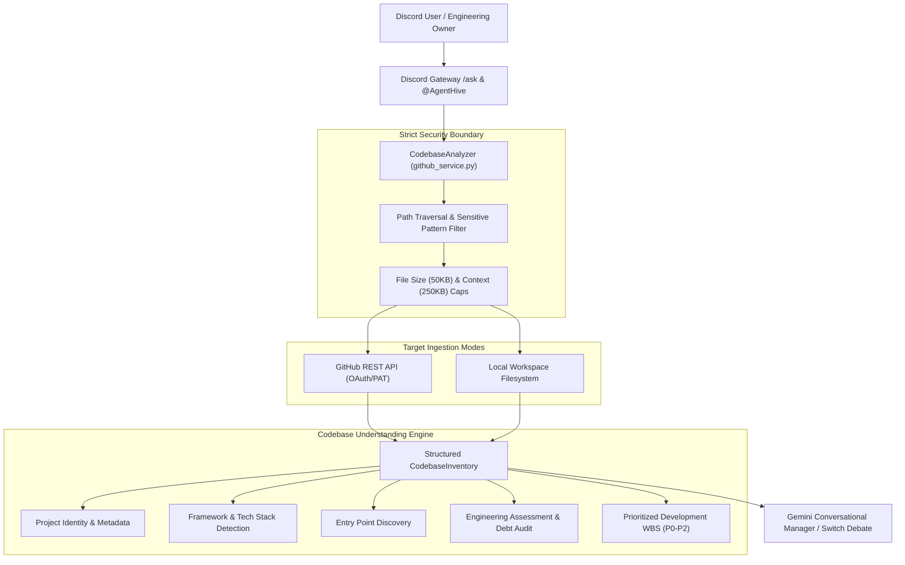

# GitHub Integration & Codebase Understanding Engine

This document details the architecture, security controls, analysis pipeline, and API specification for MindHive's GitHub Repository Integration and Codebase Understanding Engine.

---

## 1. Overview & Architectural Role

MindHive connects to both remote GitHub repositories (public or authenticated private) and local repository checkouts to extract comprehensive architectural context without executing downloaded code.

---

## 2. Authentication & Authorization

### Fine-Grained Personal Access Tokens (PAT)
- **Required Permissions:** `Contents: Read-only`, `Metadata: Read-only`.
- **Public Repositories:** No token is strictly required (subject to GitHub IP rate limits: 60 requests/hr).
- **Private Repositories:** Requires `GITHUB_TOKEN` configured in `.env` or passed via administrative settings.
- **Credential Hygiene:**
  - `GITHUB_TOKEN` is loaded securely on the backend into `settings.github_token`.
  - Never exposed in Discord embeds, frontend JavaScript, API error responses, or application logs.
  - All outgoing strings are processed through `redact_secrets()`.

### Rate Limit Management
- Tracks GitHub response headers `X-RateLimit-Remaining` and `X-RateLimit-Reset`.
- Automatically enforces proactive backoff and raises structured `PermissionError("GitHub API rate limit exceeded")` before socket exhaustion.

---

## 3. Strict Security & Isolation Boundaries

MindHive treats all ingested repository contents as untrusted data:

| Security Rule | Implementation | Threat Prevented |
| :--- | :--- | :--- |
| **No Code Execution** | Files are read strictly as UTF-8 text via REST API or read-only filesystem calls. Subprocess execution, evaluation, and build triggers are forbidden during analysis. | Arbitrary Remote Code Execution (RCE) from untrusted pull requests/repos. |
| **Path Traversal Guard** | `validate_relative_path()` rejects any path containing `..`, leading `/`, `~`, or null bytes (`\0`). | Unauthorized host filesystem reads. |
| **Sensitive File Exclusion** | Matches against `SENSITIVE_PATTERNS` (`.env*`, `*.pem`, `*.key`, `*secret*`, `*credential*`, `*token*`, etc.). | Leaking environment variables, private keys, or credentials. |
| **Directory Filtering** | `IGNORED_DIRS` skips `.git`, `node_modules`, `venv`, `dist`, `build`, etc. | Denial-of-service via huge dependencies or circular symlinks. |
| **Binary Exclusion** | `BINARY_EXTENSIONS` ignores images, audio, video, archives, compiled binaries (`.so`, `.pyc`, `.dll`). | Buffer bloat and decoding errors. |
| **Bounded Ingestion Caps** | Maximum 50 KB per inspected file; maximum 250 KB aggregate source text limit; maximum 500 tree entries indexed. | Denial-of-service via massive files or repo bloat. |

---

## 4. Codebase Understanding Engine Outputs

Every analyzed repository produces a structured `CodebaseInventory` object containing:

### 1. Project Identity
- **Name & Owner:** Identified from repository metadata or directory name.
- **Description & Purpose:** Synthesized from `README.md` and repo manifest tags.
- **Intended Users:** Derived from product descriptions and CLI/UI interfaces.

### 2. Technical Architecture
- **Primary Languages:** Detected from file extensions and GitHub language breakdown (`.py`, `.ts`, `.js`, `.go`, `.rs`, etc.).
- **Frameworks & Libraries:** Automated heuristic inspection of manifests (`requirements.txt`, `package.json`, `Cargo.toml`, `go.mod`, `Dockerfile`):
  - Web & API: FastAPI, Uvicorn, Flask, Django, Express.js, Next.js, React.
  - Messaging & Chat: Discord.py, WebSockets, SSE.
  - Data & Storage: PostgreSQL, SQLite (WAL), Redis.
  - Testing & Containerization: Pytest, Docker, Docker Compose.
- **Entry Points:** Automated detection of application lifespans (e.g. `agenthive/main.py`, `app.py`, `server.js`, `cmd/main.go`).

### 3. Engineering Assessment
- **Observed Capabilities:** Real working subsystems verified by manifest and entry point inspection.
- **Incomplete Features / Gaps:** Missing CI/CD pipelines (`.github/workflows`), missing automated tests, or unconfigured container definitions.
- **Security & Technical Debt:** Origin boundaries, secret handling, and subprocess isolation audits.
- **Testing State:** Presence of Pytest or unit test suites in `tests/`.

### 4. Improvement Recommendations (Prioritized WBS)
- **P0 (Highest):** Fundamental architectural consensus and multi-agent coordination.
- **P1 (High):** Hardened sandboxing, non-root execution, and security boundaries.
- **P2 (Medium):** Quality assurance, adversarial edge-case testing, and dependency simplification.
- Every recommendation specifies:
  - Priority Level
  - Technical Rationale
  - Estimated Complexity (e.g., `Medium (2–4 hours)`)
  - Responsible Agent Assignment (Codex, AGY, Gemini, Hermes)
  - Explicit Dependencies

---

## 5. Verification & Automated Tests

Automated test coverage for GitHub integration is maintained in `tests/test_github_integration.py`:
- `test_parse_repo_target`: Full URLs, `owner/repo` slugs, local directory paths, empty inputs.
- `test_sensitive_file_exclusion`: Verification that `.env`, `id_rsa`, `.key`, `token` files are omitted.
- `test_path_traversal_prevention`: Traversal escapes (`../`, `/etc/shadow`, null bytes) are blocked.
- `test_local_codebase_analysis_and_understanding`: End-to-end extraction from a mock project tree with manifests and tests.
- `test_github_service_rate_limit_handling`: Verified rate limit exception handling without credential disclosure.
