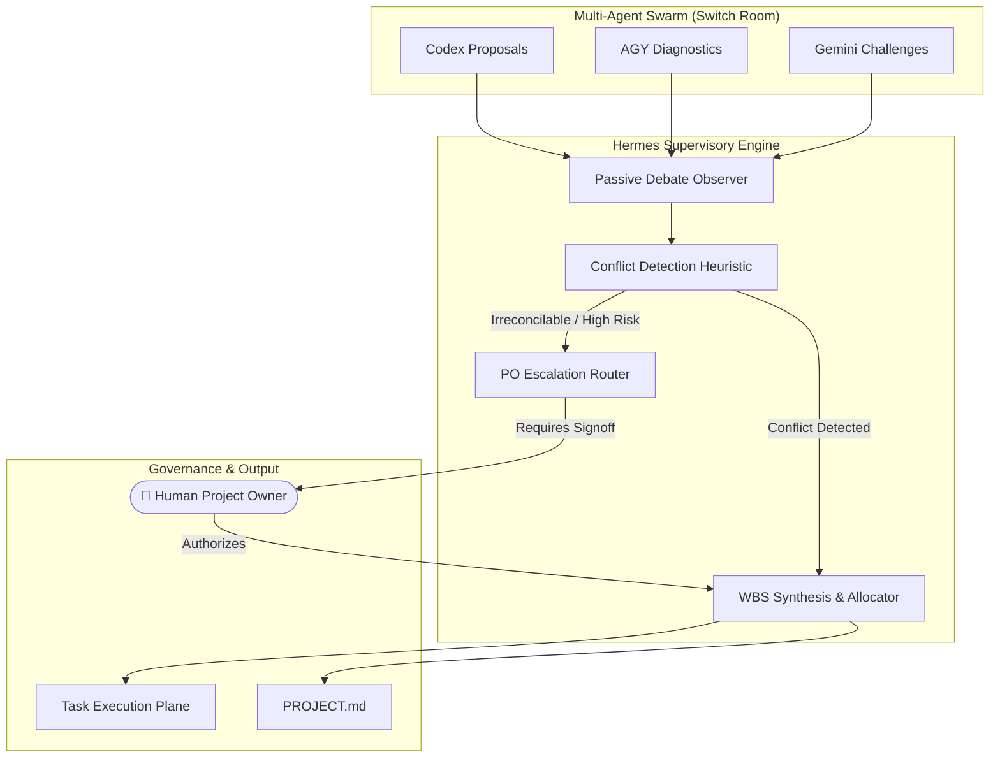
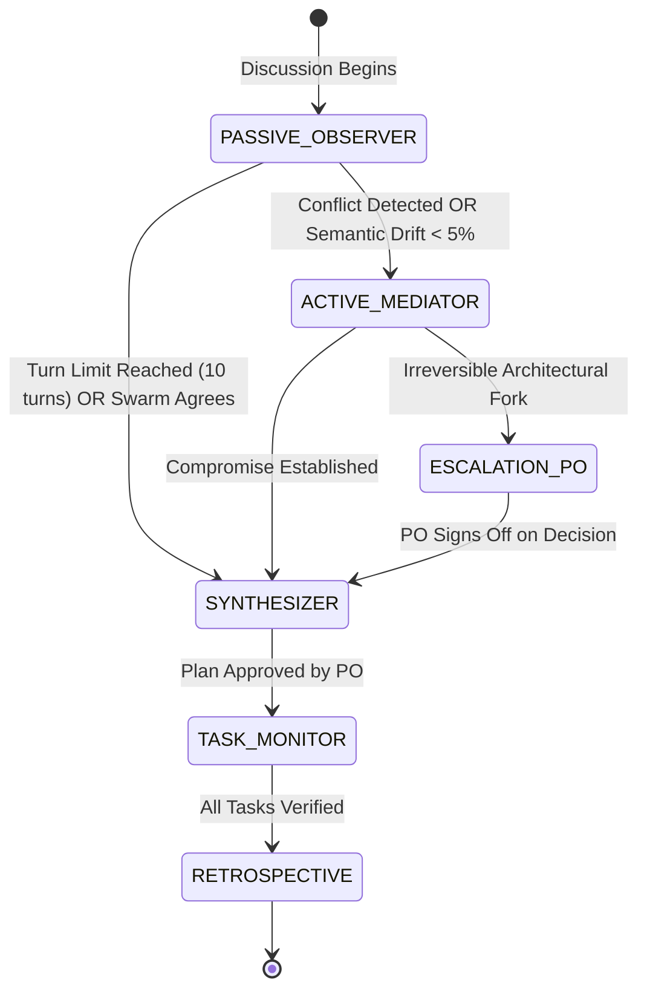

# AgentHive — Hermes Supervision Architecture (`HERMES_SUPERVISION.md`)

This document defines the architecture, decision matrices, conflict resolution algorithms, task distribution heuristics, and escalation protocols governing **Hermes**, the supervising AI agent in **AgentHive**.

---

## 1. Role and Cardinal Mandates

Hermes (powered by the Nous Research Hermes Agent framework) is the executive coordinator of AgentHive. Hermes ensures that the agent swarm operates as a cohesive, disciplined engineering unit rather than a chaotic chatroom.



### Cardinal Mandates for Hermes:
1. **Never Silently Override the Human:** Hermes must never reverse or modify an explicit decision made by the Project Owner. If an agent discovers a fatal flaw in a user directive, Hermes must escalate the issue transparently rather than making silent unilateral changes.
2. **Neutral Arbiter:** Hermes does not favor Codex over Gemini or AGY. Rulings are grounded strictly in the project requirements defined in `PROJECT.md` and Pony Tail simplicity.
3. **Action-Oriented Synthesis:** Hermes terminates debates once diminishing returns set in, driving the discussion toward concrete, assignable tasks.

---

## 2. Supervision Lifecycle & Intervention Heuristics

Hermes operates on three distinct modes throughout a project:



### 2.1 Mode A: Passive Observer (Turns 1–4)
- Hermes listens quietly as Codex opens with system architecture, AGY reviews system dependencies, and Gemini stress-tests assumptions.
- Hermes logs arguments into an internal semantic graph, mapping dependencies and trade-offs.

### 2.2 Mode B: Active Mediator (Turns 5–9)
Hermes actively intervenes under the following triggers:
- **Direct Contradiction:** Codex proposes a synchronous blocking architecture while Gemini requires non-blocking async for websocket scalability.
- **Dependency Drift:** An agent suggests adding an external library that violates Pony Tail rules (e.g. installing a full ORM for a 2-table schema).
- **Circular Debate:** Semantic analysis reveals agents are restating the same arguments with zero net information gain across two consecutive turns.

### 2.3 Mode C: Synthesizer & Task Allocator (Turn 10 or Early Consensus)
- Closes the debate floor.
- Formulates the structured Work Breakdown Structure (WBS).
- Matches each task to an agent according to the **Capability Allocation Matrix**.
- Submits the plan to Discord for human approval.

---

## 3. Conflict Detection & Resolution Matrix

When opposing proposals clash, Hermes applies a deterministic resolution hierarchy:

| Conflict Domain | Example Scenario | Hermes Resolution Heuristic |
|---|---|---|
| **Tech Stack & Libraries** | Codex wants `pydantic-settings`; AGY proposes standard library `os.environ` + `dataclasses`. | **Rule of Minimalism:** Favor standard library unless validation complexity exceeds 50 LOC. AGY wins. |
| **Architecture Pattern** | Codex proposes a multi-file modular repository; AGY recommends a single clean script for the MVP. | **Project Scope Anchor:** Check `PROJECT.md`. If project is marked "MVP / Prototype", favor simpler monolithic structure. |
| **Data Persistence** | Gemini proposes PostgreSQL for relational safety; Codex proposes SQLite with WAL mode. | **Operational Simplicity:** If concurrent writes < 1,000 ops/sec and local deployment is required, SQLite wins. |
| **Security vs. Ergonomics** | Gemini flags potential injection vulnerability in regex engine; Codex argues regex is constrained. | **Security Absolute Priority:** Gemini wins. Safe regex bounds or parsing algorithms must be adopted. |
| **Irreversible Fork** | Agent swarm is split 50/50 on whether to build a REST API or a GraphQL endpoint. | **Escalation Trigger:** Hermes freezes debate and requests human Project Owner input via Discord embed. |

---

## 4. Role & Task Allocation Algorithm

Hermes allocates tasks using a deterministic scoring model based on task attributes:

```python
# Hermes Task Allocation Heuristic (Pseudo-algorithm)
def assign_task_to_agent(task):
    if task.category == "DATA_MODEL_OR_BACKEND":
        # Codex excels in typed models, data structures, and algorithmic logic
        return "ChatGPT Codex"
    elif task.category in ["CLI_HARNESS", "DOCKER_SANDBOX", "SYSTEM_INTEGRATION"]:
        # AGY excels in build tooling, OS dependencies, and CLI plumbing
        return "AGY"
    elif task.category in ["TEST_SUITE", "BENCHMARK_MATRIX", "FUZZING", "SECURITY_AUDIT"]:
        # Gemini excels in edge-case generation, risk audits, and test design
        return "Gemini"
    else:
        # Default allocation based on current agent workload
        return get_least_loaded_agent()
```

### Allocation Rules:
1. **Single Accountability:** Every task has exactly ONE assigned agent. Shared ownership is strictly prohibited to prevent race conditions and conflicting edits.
2. **Strict Test Separation:** The agent that writes the implementation code (Codex) is NEVER assigned to write the verification tests. Gemini writes the test suites to ensure an adversarial, independent evaluation.
3. **Pony Tail Verification:** Every task specification includes explicit constraints (e.g. `Allowed Packages: None (Standard Library Only)`).

---

## 5. Project Owner Escalation Protocol

When an escalation is triggered, Hermes generates a structured Discord embed in `#project-<slug>-approvals`:

```text
+-------------------------------------------------------------------------------+
|  ⚠️ HERMES ESCALATION — ARCHITECTURAL FORK DETECTED                           |
|  Project: LogStream | Urgency: HIGH                                           |
+-------------------------------------------------------------------------------+
|  The agent swarm has reached an architectural crossroad requiring human       |
|  direction. Both options are viable, but have distinct operational trade-offs:|
|                                                                               |
|  Option A: SQLite with WAL (Proposed by Codex & AGY)                          |
|  • Pros: Zero setup, single-file portability, instant local startup.          |
|  • Cons: Concurrent write bottleneck under distributed multi-host loads.      |
|                                                                               |
|  Option B: Redis In-Memory Key-Value Store (Proposed by Gemini)               |
|  • Pros: Sub-millisecond latency, pub/sub channels, native TTL eviction.      |
|  • Cons: Requires Docker service dependency, higher memory footprint.        |
+-------------------------------------------------------------------------------+
|  [ Choose Option A (SQLite) ]              [ Choose Option B (Redis) ]        |
+-------------------------------------------------------------------------------+
```

---

## 6. Progress Tracking & Retrospective Generation

During Phase 6 (Execution), Hermes tracks container outputs:
- **Live Status Monitoring:** Maintains state of all WBS tasks (`IN_PROGRESS`, `TESTS_RUNNING`, `VERIFIED`, `FAILED`).
- **Regression Management:** If tests fail, Hermes aggregates the traceback, checks if the retry count is under 3, and dispatches a targeted bugfix task to the assigned agent.
- **Final Project Retrospective:** Once all tests pass, Hermes updates `PROJECT.md` with an executive summary:
  - Total debate turns taken.
  - Conflicts identified and how they were resolved.
  - Final test metrics (e.g. 24 passed tests, 98% coverage).
  - List of created files and verification commands.
