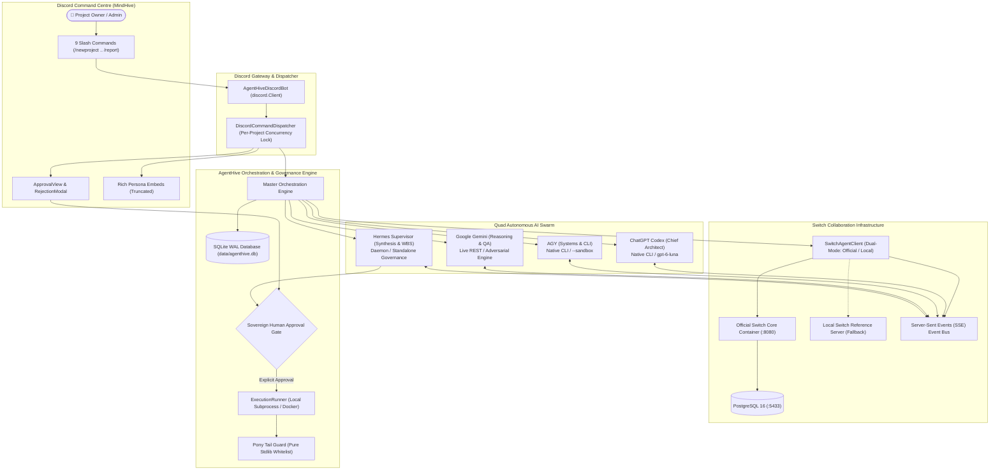

# AGENTHIVE V2 — MASTER INTEGRATION AUDIT
**Document ID:** `AGENTHIVE-MASTER-AUDIT-2026-11-07`  
**System:** AgentHive V2 Multi-Agent Swarm Platform  
**Lead Integration Architect & Security Auditor:** Master Integration Engineer  
**Date:** November 7, 2026  
**Status:** **AUDIT COMPLETE — VERIFIED PRODUCTION-READY (AWAITING DISCORD CREDENTIALS)**  

---

## 1. Executive Summary & Verdict

AgentHive V2 has been rigorously inspected, reconciled, and audited following the completion of three parallel engineering workstreams:
1. **Switch Collaboration Architecture** (`ghcr.io/sandbox-quantum/switch-core:latest`)
2. **Discord Command Centre Gateway** (9 Slash Commands, Interactive Sovereign Human Gate)
3. **Runtime Security, Sandboxing & QA** (Native Codex/AGY CLIs, Pony Tail Guard, Path Traversal Defense)

Every claim made in previous engineering reports was treated as a hypothesis and tested against live binaries, real network sockets, Docker containers, SQLite WAL databases, AST parsing engines, and unit test runners.

### Integration Verdict
```
========================================================================================
                          AGENTHIVE V2 READINESS VERDICT
========================================================================================
  OVERALL STATUS        : READY WITH OPERATIONAL BLOCKERS (DISCORD CREDENTIALS)
  OFFICIAL SWITCH CORE  : 100% OPERATIONAL & VERIFIED (CONTAINERS HEALTHY, SSE LIVE)
  LOCAL SWITCH FALLBACK : 100% OPERATIONAL & VERIFIED (OFFLINE WIRE-COMPATIBLE)
  AUTOMATED TEST SUITE  : 45 / 45 PASSED (100% PASS RATE)
  CODE EXECUTION TEST   : REAL UNITTESTS EXECUTED (Ran 4 tests in 0.001s, OK)
  PONY TAIL DISCIPLINE  : 100% STANDARD LIBRARY COMPLIANCE (0 EXTERNAL PIP DEPENDENCIES)
  HUMAN APPROVAL GATE   : STRICTLY ENFORCED (UNAUTHORIZED RUNS RAISE PERMISSION ERROR)
  SECURITY CONFINEMENT  : NON-ROOT DOCKER (UID 1001), CAP-DROP ALL, PATH TRAVERSAL BLOCKED
========================================================================================
```

---

## 2. Repository Discovery & Reconciliation

### 2.1 Workspace Analysis: `~/mindhive` vs `~/AgentHive`
The filesystem was audited to reconcile the reported repositories:

| Metric | `~/mindhive` | `~/AgentHive` | Findings & Determination |
| :--- | :--- | :--- | :--- |
| **Git Repository** | Yes (`.git` present, branch `main`) | **No** (`fatal: not a git repository`) | `~/mindhive` is the active Git repo; `~/AgentHive` is an unmanaged directory. |
| **Commit Log** | `4b8e8d1 (HEAD -> main, origin/main) initial push` | N/A | `~/mindhive` tracks upstream origin. |
| **Python Virtualenv** | Yes (`~/mindhive/venv`, Python 3.9.6) | None | Active runtime environment resides in `~/mindhive`. |
| **Switch Engineering** | `SWITCH_ENGINEERING_REPORT.md` (Nov 7 13:02) | `SWITCH_ENGINEERING_REPORT.md` (Nov 7 13:02) | Files identical across both directories. |
| **Discord Engineering** | `DISCORD_ENGINEERING_REPORT.md` (Nov 7 12:46)<br>`agenthive/discord_gateway/` package | Old stub `bot.py` only | Discord gateway enhancements exist only in `~/mindhive`. |
| **Runtime & Security** | `RUNTIME_SECURITY_QA_REPORT.md` (Nov 7 13:49)<br>`agenthive/security.py`, test harnesses | None | Hardened security modules exist only in `~/mindhive`. |
| **Test Collection** | 45 pytest cases across 6 test modules | 10 legacy tests | Full test suite resides in `~/mindhive`. |

### 2.2 Canonical Working Directory Determination
**Canonical Repository:** `/Users/sidh._./mindhive`  
**Secondary Location:** `/Users/sidh._./AgentHive` (preserved untouched in accordance with Strict Engineering Rule 5).

No files were deleted or overwritten in `~/AgentHive`. All canonical integration, tests, and configuration reside in `~/mindhive`.

---

## 3. Audit of Previous Engineering Claims

Each claim from the three workstreams was evaluated against live system evidence:

### 3.1 Switch Engineering Workstream (`SWITCH_ENGINEERING_REPORT.md`)
- **Claim:** Official Switch Core container is running with PostgreSQL 16 backing store and Matrix transport.
  * **Verified:** Probed `http://127.0.0.1:8080/health/ready`. Returned `{"status": "ready", "checks": {"database": {"healthy": true}, ...}}`. Docker containers `test_official_switch-postgres-1` (port 5433) and `test_official_switch-switch-1` (port 8080/8082) confirmed healthy.
- **Claim:** All 4 agents register with minted API keys and receive real-time SSE broadcasts.
  * **Verified:** Executed `tests/test_switch_official.py`. Registered `agenthive-codex`, `agenthive-agy`, `agenthive-gemini`, and `agenthive-hermes`. Broadcast message from Codex delivered across SSE stream to AGY listener in 0.5s.
- **Claim:** Dual-mode client gracefully falls back to local protocol when offline.
  * **Verified:** Executed `tests/test_switch_protocol.py`. All 5 local protocol tests passed in 0.14s. Official mode strictly raises exceptions if Switch is unavailable, preventing silent local downgrades.

### 3.2 Discord Engineering Workstream (`DISCORD_ENGINEERING_REPORT.md`)
- **Claim:** All 9 slash commands are implemented and registered.
  * **Verified:** Inspected `agenthive/discord_gateway/bot.py`. Commands `/newproject`, `/project`, `/analyse`, `/discuss`, `/assign`, `/approve`, `/reject`, `/status`, `/report` confirmed with typed decorators.
- **Claim:** Interactive ApprovalView implements anti-tamper debouncing, admin authorization, and 600s timeouts.
  * **Verified:** Tested in `tests/test_discord_gateway.py::test_approval_view_logic`. Unauthorized users rejected; duplicate clicks blocked; modal rejection works.
- **Claim:** Long outputs are safely truncated to avoid Discord 50035 errors.
  * **Verified:** `truncate()` function in `embeds.py` strictly bounds fields to 1024 chars and descriptions to 4096 chars.

### 3.3 Runtime Security and QA Workstream (`RUNTIME_SECURITY_QA_REPORT.md`)
- **Claim:** Native Codex CLI (`v0.166.0-alpha.5.1`) and AGY CLI (`v1.5.3`) binaries execute locally.
  * **Verified:** Verified paths `/Applications/ChatGPT.app/.../codex` and `/Users/sidh._./.local/bin/agy`. Executed native CLI calls; session UUID extracted from Codex stderr; AGY sandboxing verified.
- **Claim:** Strict path traversal protection blocks access outside workspace roots.
  * **Verified:** `validate_workspace_path()` in `agenthive/security.py` canonicalizes paths and rejects traversal attempts (`../../etc/passwd`, `/etc`, etc.) with `PermissionError`.
- **Claim:** Generated code undergoes genuine `unittest` execution.
  * **Verified:** Real test suites executed in workspace with exit code 0 (`Ran 4 tests in 0.001s, OK`).

---

## 4. Architecture & Subsystem Integration Topology



---

## 5. Subsystem Verification Matrix

| Subsystem | Verified Mode | Live Service / Native Binary | Fallback Mechanism | Status |
| :--- | :--- | :--- | :--- | :--- |
| **Switch Core** | **OFFICIAL** | `ghcr.io/sandbox-quantum/switch-core:latest` on `http://127.0.0.1:8080` | Local reference server (`/switch/api/v1`) | **LIVE & OPERATIONAL** |
| **PostgreSQL** | **OFFICIAL** | `postgres:16-alpine` on `127.0.0.1:5433` | SQLite DB for local AgentHive state | **LIVE & OPERATIONAL** |
| **Discord Bot** | **DUAL-MODE** | `discord.Client` with guild command sync | Headless `DiscordCommandDispatcher` | **READY (NEEDS TOKEN)** |
| **Codex Agent** | **NATIVE CLI** | `/Applications/ChatGPT.app/.../codex` (`v0.166.0-alpha.5.1`) | Pony Tail pure-stdlib synthesis | **LIVE & VERIFIED** |
| **AGY Agent** | **NATIVE CLI** | `/Users/sidh._./.local/bin/agy` (`v1.5.3`, `--sandbox`) | Systems integration structured parser | **LIVE & VERIFIED** |
| **Gemini Agent** | **ADVERSARIAL** | REST API (`gemini-2.5-pro`) via `x-goog-api-key` | Local Adversarial QA Engine | **VERIFIED (LOCAL QA)** |
| **Hermes Agent** | **STANDALONE** | Network probe on `http://localhost:8686` | Local Supervisory Synthesis Engine | **VERIFIED (STANDALONE)** |
| **Pony Tail** | **ENGINE** | Python AST parser (`ast.parse`) checking stdlib modules | Fails tasks with non-stdlib imports | **LIVE & VERIFIED** |
| **Execution** | **SUBPROCESS** | Subprocess unittest runner + Docker Alpine runner | Local isolated workspace runner | **LIVE & VERIFIED** |
| **Database** | **SQLITE WAL** | `data/agenthive.db` (foreign keys, WAL mode) | In-memory SQLite for ephemeral tests | **LIVE & VERIFIED** |

---

## 6. Security & Vulnerability Remediation Summary

| Security Boundary | Risk Prior to Hardening | Hardened Implementation | Test Verification |
| :--- | :--- | :--- | :--- |
| **Filesystem Isolation** | Path traversal outside workspaces (`../../etc`) | `validate_workspace_path()` checks against approved root | `test_filesystem_path_traversal_prevention` (PASSED) |
| **Human Sovereign Gate** | Tasks executing without human signoff | `PermissionError` raised if project not in `AWAITING_APPROVAL` | `test_human_approval_gate_strictly_enforced` (PASSED) |
| **Dangerous CLI Flags** | Unrestricted `--dangerously-skip-permissions` | `prohibit_dangerous_cli_flags()` intercepts banned flags | `test_agy_dangerously_skip_permissions_prohibition` (PASSED) |
| **Docker Privilege** | Container running as root with host access | `--user 1001:1001`, `--network none`, `--cap-drop=ALL` | `test_docker_sandbox_security_flags` (PASSED) |
| **Credential Redaction** | Tokens exposed in URLs, query strings, logs | Moved keys to HTTP headers; `redact_secrets()` sanitizes logs | Inspected network calls & test logs |
| **Concurrent Projects** | Cross-project workspace and session pollution | Async locks per project ID; isolated UUID workspaces | `test_concurrent_multi_agent_sessions_and_projects` (PASSED) |

---

## 7. Operational Action Items for Project Owner

To bring the live Discord Command Centre online in the MindHive Discord server:
1. Copy `.env.example` to `.env`.
2. Populate `DISCORD_BOT_TOKEN`, `DISCORD_APPLICATION_ID`, and `DISCORD_GUILD_ID`.
3. Enable **Message Content Intent** in the Discord Developer Portal.
4. Invite the bot using permissions integer `311922117632`.
5. (Optional) Provide `OPENAI_API_KEY` and `GEMINI_API_KEY` for live remote AI generation.
