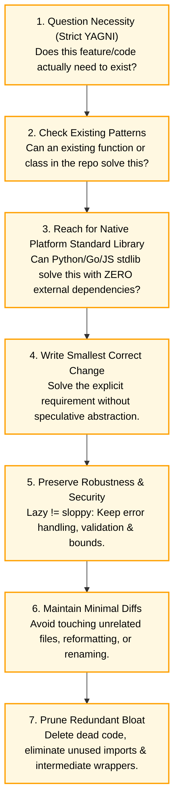

# AgentHive — Pony Tail Skill Integration (`PONYTAIL_INTEGRATION.md`)

This document defines the integration of the **Pony Tail** skill (authored by Dietrich Gebert) into **AgentHive**. It details how Pony Tail's philosophy, the **7-Step Ladder of Laziness**, and execution guardrails prevent AI code bloat and govern development workflows under Hermes's supervision.

---

## 1. Skill Philosophy & The Problem it Solves

AI coding models naturally suffer from eager over-engineering:
- Asked to build a simple cache, a model might install Redis, an async ORM, Celery, and custom decorators.
- Asked for a date picker, a model might install two npm libraries and create 300 lines of wrapper boilerplate.

**Pony Tail** introduces **"the laziest senior developer in the room"** into AgentHive.
Its guiding maxim is:
> **"The best code is the code you never wrote."**

Pony Tail forces coding agents (Codex and AGY) to pause, question assumptions, reject speculative future-proofing, and write the absolute smallest correct diff that fulfills the Project Owner's explicit requirements.

---

## 2. The 7-Step "Ladder of Laziness"

AgentHive integrates the 7-step decision ladder as a non-negotiable prompt filter and code review rubric:



1. **Question Necessity (YAGNI - You Aren't Gonna Need It):** If a requirement was not explicitly requested in `PROJECT.md`, do not write it. Speculative "future extensibility" is treated as a defect.
2. **Inspect Existing Patterns:** Before authoring a new helper, scan the workspace. Reuse existing abstractions rather than writing novel variations.
3. **Favor Native Platform Features & Standard Libraries:**
   - Use Python's `pathlib`, `json`, `sqlite3`, `re`, `asyncio`, `urllib.request` before installing `requests`, `aiofiles`, or third-party ORMs.
   - Use native browser `<dialog>` and `<input type="date">` before reaching for heavy UI component packages.
4. **Write the Smallest Correct Change:** Deliver working software in the minimum number of lines of code.
5. **Preserve Robustness & Security:** Laziness does not excuse carelessness. Full input validation, boundary checking, and error handling must be maintained.
6. **Produce Minimal Diffs:** Code reviews must be transparent. Agents are penalized for gratuitous file restructuring or vanity reformatting.
7. **Prune Redundancy:** Eliminate intermediate abstractions, single-use utility wrappers, and dead imports.

---

## 3. Operational Modes & Configuration

Pony Tail operates at four intensity levels, configurable per project in `PROJECT.md` or `.env`:

| Mode | Behavior | Best Suited For |
|---|---|---|
| `lite` | Reminds agent to check standard libraries before installing common packages. | Prototyping complex full-stack apps with established ecosystems. |
| **`full` (Default)** | Strictly enforces the 7-step ladder. Blocks new external package additions without Hermes approval. | Standard AgentHive projects, CLI tools, backend microservices. |
| `ultra` | Zero new dependencies allowed under any circumstance. Maximum 100 LOC per task. Rejects all abstractions. | Hackathon MVPs, performance-critical algorithmic tasks, micro-utilities. |
| `off` | Disables Pony Tail constraints. Standard unrestricted agent output. | Exploratory research spikes (not recommended). |

---

## 4. Interaction with Coding Agents and Hermes

Pony Tail operates at two key checkpoints in the AgentHive architecture:

```mermaid
sequenceDiagram
    autonumber
    participant H as Hermes Supervisor
    participant C as Codex (Coder)
    participant PT as Pony Tail Engine
    participant Box as Docker Sandbox

    H->>C: Assign TASK-01 (Pony Tail: FULL mode)
    C->>PT: Draft Implementation
    PT-->>C: Pass: 0 new dependencies, native stdlib used
    C->>Box: Submit code patch to container
    Box->>PT: AST / Dependency Inspection
    alt Unapproved Package Detected (e.g. import requests)
        PT-->>Box: Reject: Dependency violation (use urllib.request)
        Box-->>C: Error feedback: Prune dependency
    else Valid Minimal Diff
        Box-->>H: Report clean task completion
    end
```

### 4.1 Prompt-Level Injection (Codex & AGY)
When tasks are assigned, the AgentHive Orchestrator injects the Pony Tail ruleset into the agent's task-execution prompt:
```text
[PONY TAIL DISCIPLINE ACTIVE: MODE=FULL]
1. Do not add external dependencies to requirements.txt or package.json unless explicitly authorized.
2. Use native standard library solutions.
3. Implement the minimal correct diff. Any speculative helper functions will be rejected by Hermes.
```

### 4.2 Hermes as the Pony Tail Auditor
During Phase 4 (Synthesis) and Phase 6 (Execution), Hermes acts as the enforcer:
- If Codex suggests importing an external library during debate, Hermes prompts: *"Can this be achieved with native standard library? Justify why external dependency is required."*
- If the justification fails, Hermes strikes the dependency from the WBS.

---

## 5. Security & Execution Boundaries (No Unrestricted Execution)

A critical architectural mandate is that **Pony Tail must never grant unrestricted execution permissions**:

1. **No Direct Host Execution:** Pony Tail scripts, code generation commands, and test runners execute exclusively inside ephemeral Docker sandboxes.
2. **Whitelisted CLI Commands:** The execution plane restricts shell execution to an approved set of build and test tools:
   - Allowed: `python3 -m pytest`, `python3 -m unittest`, `go test`, `npm test`, `git diff`.
   - Denied: `curl`, `wget`, `bash -c`, `sudo`, `chmod`, `rm -rf`, access to `/proc`, `/sys`, or environment variables outside container scope.
3. **Dependency Lock-In:** Ephemeral containers run with `network_mode: none`. Even if an agent attempts to execute `pip install <package>`, the command fails immediately due to network isolation. Package additions require explicit Project Owner authorization in Discord to temporarily toggle network access during container build time.
