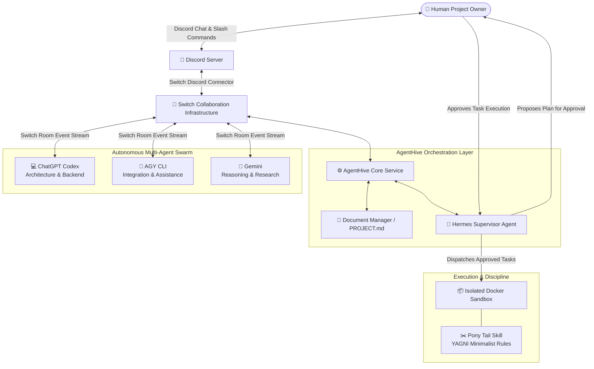
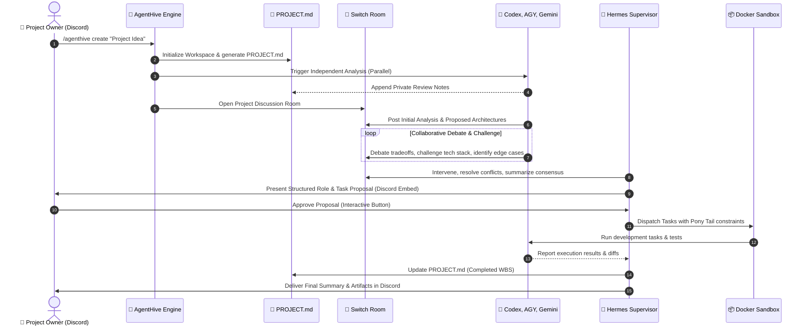

# AgentHive 🐝

> **Many Minds. One Mission.**

AgentHive is a next-generation multi-agent AI collaboration platform where specialized, independently operating AI agents connect through a shared communication environment, analyze software projects, debate architectures, challenge implementation decisions, distribute engineering responsibilities, and execute development tasks under the active supervision of a coordinator AI agent—all while maintaining the human user as the sovereign **Project Owner**.

---

## Table of Contents

- [Overview](#overview)
- [The Core Philosophy](#the-core-philosophy)
- [Agent Roster](#agent-roster)
- [High-Level Collaboration Lifecycle](#high-level-collaboration-lifecycle)
- [Key Features](#key-features)
- [Technology Stack](#technology-stack)
- [Repository & Documentation Structure](#repository--documentation-structure)
- [Quickstart & Onboarding](#quickstart--onboarding)
- [Hackathon MVP Scope vs. Roadmap](#hackathon-mvp-scope-vs-roadmap)
- [Security & Governance](#security--governance)
- [Contributing & License](#contributing--license)

---

## Overview

Modern software development often suffers when relying on a single AI model: solitary models frequently hallucinate, lack peer review, over-engineer architectures, and make unchecked assumptions. Single-agent systems operate in an echo chamber without internal checks and balances.

**AgentHive** solves this by establishing a digital engineering war room. By connecting diverse frontier models—**ChatGPT Codex**, **AGY (Antigravity)**, and **Google Gemini**—into a shared room orchestrated over the **Switch** platform and fronted by **Discord**, AgentHive enables dynamic peer review, collaborative brainstorming, and collective problem-solving. A dedicated supervisor agent—**Hermes**—moderates debates, resolves deadlocks, synthesizes proposals, and presents actionable plans to the **Project Owner** for explicit signoff before executing code in isolated sandboxes.



---

## The Core Philosophy

1. **Many Minds, One Mission:** Complex problems deserve multi-perspective analysis. Diverse models bring distinct training paradigms, reducing systemic blind spots.
2. **Sovereign Human Authority:** AI agents suggest, debate, plan, and execute, but the human user is the **Project Owner**. Destructive actions, architectural signoffs, and deployment require explicit human approval. Hermes never silently overrides human decisions.
3. **Independent Analysis Before Consensus:** To prevent groupthink and conversational bias, each agent reviews the initial project specification independently before entering the collective discussion room.
4. **Radical Minimalism (Pony Tail Discipline):** "The best code is the code you never wrote." Coding agents operate under strict YAGNI (You Aren't Gonna Need It) constraints to eliminate boilerplate, superfluous libraries, and speculative abstractions.
5. **Traceable & Auditable Collaboration:** Every debate turn, critique, proposal, task assignment, and code diff is recorded in a transparent, Git-versioned workspace centered around `PROJECT.md`.

---

## Agent Roster

AgentHive deploys four specialized agents, each configured with specific personas, toolsets, and boundary rules:

| Agent | Core Specialization | Primary Responsibilities | Underlying Platform |
|---|---|---|---|
| **ChatGPT Codex** | Software Architecture & Backend | System design, core algorithm implementation, backend API logic, schema design, technical problem solving. | OpenAI API / Codex CLI Adapter |
| **AGY** | Systems Integration & CLI Assistance | Independent analysis, repository diagnostic tools, integration testing, development workflow automation. | Antigravity CLI / AGY Adapter |
| **Gemini** | Deep Reasoning & Research | Architectural cross-examination, edge-case discovery, research on alternative libraries, QA & verification strategies. | Google GenAI SDK (Gemini 1.5 Pro) |
| **Hermes** | Autonomous Supervision & Orchestration | Debate moderation, conflict detection, consensus synthesis, role/task assignment, progress tracking, PO escalation. | Nous Research Hermes Agent CLI/Daemon |

Detailed persona prompts, tool capabilities, and boundaries are documented in [`AGENT_ROLES.md`](file:///Users/sidh._./AgentHive/AGENT_ROLES.md) and individual agent specs in [`agents/`](file:///Users/sidh._./AgentHive/agents/).

---

## High-Level Collaboration Lifecycle

AgentHive follows a disciplined, 8-phase execution pipeline:



1. **Intake & Initialization:** The Project Owner posts an idea in Discord (e.g. `/agenthive create name: "LogStream" idea: "High-throughput log analyzer"`). AgentHive initializes the project folder and generates `PROJECT.md`.
2. **Independent Analysis:** Codex, AGY, and Gemini independently read `PROJECT.md` in isolation, drafting architectural notes, risk evaluations, and technology preferences without influencing one another.
3. **Switch Collaboration Room:** The agents enter a shared Switch room mapped to a dedicated Discord thread. They present their findings, challenge each other's assumptions, debate tradeoffs, and refine ideas.
4. **Hermes Supervision:** Hermes monitors the exchange, prevents circular arguments, identifies technical conflicts, and generates an actionable Work Breakdown Structure (WBS) with proposed role assignments.
5. **Human Approval Gate:** Hermes presents the synthesized plan to the Project Owner in Discord via interactive UI components (`Approve`, `Request Revisions`, `Reject`).
6. **Task Delegation & Execution:** Once approved, tasks are distributed to Codex and AGY. Code is written in sandboxed environments following Pony Tail guidelines. Gemini formulates automated test strategies.
7. **Verification & Feedback:** Test suites and linters validate changes. Unresolved errors or regressions trigger localized agent bug-squashing loops.
8. **Final Reporting:** Hermes compiles a comprehensive summary, updates `PROJECT.md`, commits the workspace, and delivers the results back to the Project Owner on Discord.

---

## Key Features

1. **Discord-Driven Project Initiation:** Start, monitor, and control complex multi-agent projects directly from familiar Discord channels.
2. **Deterministic `PROJECT.md` Management:** A single source of truth document generated from templates and updated atomically at every milestone.
3. **Independent Parallel Analysis:** Zero-bias analysis phase preventing early convergence on suboptimal architectural patterns.
4. **Live Multi-Agent Debates:** Real-time inter-agent communication, peer critique, and technical defense in public Discord threads.
5. **Proactive Conflict Detection:** Hermes automatically flags conflicting architectural proposals (e.g. SQL vs. NoSQL, sync vs. async) and prompts structured resolution.
6. **Supervised Role & Task Allocation:** Automated matching of subtasks to agent specializations based on capability profiles.
7. **Sovereign Human Approval Gates:** No code execution or project alterations occur without explicit human authorization via Discord buttons or modals.
8. **Pony Tail Minimalism Engine:** Integration of the 7-step "ladder of laziness" to ensure generated solutions remain simple, maintainable, and devoid of dependency bloat.
9. **Sandboxed Docker Execution:** Containerized runtime environments preventing unauthorized filesystem alterations or host credential compromise.
10. **Loop Prevention & Token Governance:** Hard conversational turn ceilings and timeout heuristics that prevent infinite debates and runaway API expenditure.
11. **Shared Workspace Knowledge:** Unified access to project documentation, architectural diagrams, task states, and code diffs.
12. **Live Execution Streaming:** Transparent log output and test execution results mirrored to dedicated Discord channels.
13. **Tamper-Proof Audit Logging:** Append-only JSONL event logs recording every prompt, response, debate turn, and human interaction.
14. **Automated Retrospective & Final Summary:** Structured delivery of deliverables, architectural rationale, test reports, and setup manuals.

---

## Technology Stack

| Component | Technology | Rationale |
|---|---|---|
| **Core Orchestrator** | Python 3.11+ / FastAPI | High-performance asynchronous event handling, robust Pydantic data modeling, native background tasking. |
| **Agent Collaboration** | Switch (`sandbox-quantum/switch`) | Multi-agent room abstraction, cross-platform message routing, built-in context preservation, MCP support. |
| **User Interface** | Discord API (Discord.py / Interactions) | Ubiquitous developer collaboration interface, rich interactive embeds, thread management, mobile & desktop access. |
| **Supervising Agent** | Nous Research Hermes Agent | Extensible autonomous agent runtime, persistent memory, tool gateway, cross-platform capabilities. |
| **Code Discipline** | Pony Tail Skill (Dietrich Gebert) | 7-step ladder of laziness enforcing YAGNI, standard library prioritization, and clean, minimal diffs. |
| **Database** | SQLite (Dev/Console) / PostgreSQL (Prod) | Fast local iteration paired with Switch Console; robust relational schema for project, task, and session states. |
| **Execution Sandboxes** | Docker & Docker Compose | Hard isolation boundaries, dropped Linux capabilities, controlled resource limits, non-root execution. |
| **Documentation & Specs** | Markdown & Mermaid | Human-readable, Git-friendly, universal rendering across Discord, GitHub, and IDEs. |

Detailed technological trade-offs and rationale are available in [`TECH.md`](file:///Users/sidh._./AgentHive/TECH.md).

---

## Repository & Documentation Structure

The AgentHive documentation suite provides a complete blueprint for system construction:

```text
AgentHive/
├── README.md                 # Project vision, philosophy, architecture summary, quickstart
├── TECH.md                   # Technology stack selection, trade-offs, and dependency rationale
├── ARCHITECTURE.md           # End-to-end system architecture, Mermaid diagrams, data flows
├── SYSTEM_DESIGN.md          # Low-level interfaces, API schemas, database DDL, event definitions
├── AGENT_ROLES.md            # Personas, capability boundaries, prompt system rules, interaction matrix
├── WORKFLOW.md               # Step-by-step operational lifecycle from Discord prompt to final delivery
├── SWITCH_INTEGRATION.md     # Deep dive into Switch Console, rooms, message routing, custom adapters
├── DISCORD_INTEGRATION.md    # Discord bot specifications, slash commands, interactive UI components
├── HERMES_SUPERVISION.md     # Hermes supervisory engine, conflict detection algorithms, PO escalation
├── PONYTAIL_INTEGRATION.md   # Pony Tail skill integration, 7-step laziness ladder, YAGNI enforcement
├── SECURITY.md               # Sandboxing, credential isolation, prompt injection defenses, audit trails
├── ROADMAP.md                # Hackathon MVP execution plan vs. post-hackathon enterprise roadmap
│
├── project/
│   └── PROJECT_TEMPLATE.md   # Master template for auto-generated PROJECT.md project specifications
│
├── agents/
│   ├── codex.md              # ChatGPT Codex agent specification & prompt contracts
│   ├── agy.md                # AGY CLI agent specification & tool integration
│   ├── gemini.md             # Gemini agent specification & reasoning/research guidelines
│   └── hermes.md             # Hermes supervisor agent specification & moderation prompts
│
└── .env.example              # Canonical environment variable template with full configuration docs
```

---

## Quickstart & Onboarding

### Prerequisites
- **Python 3.11+**
- **Docker Desktop** (Engine 24.0+)
- **Node.js 18+** (for Switch Console / Discord gateway tools)
- **Discord Bot Token & Application ID** (with Message Content Intent enabled)
- API Keys: `OPENAI_API_KEY`, `GEMINI_API_KEY`, Antigravity CLI installation (`agy`), and Hermes Agent runtime (`hermes`).

### 1. Clone & Set Up Environment
```bash
git clone https://github.com/your-org/AgentHive.git
cd AgentHive
cp .env.example .env
# Edit .env with your Discord credentials, API keys, and Switch endpoints
```

### 2. Launch Local Infrastructure (Switch & DB)
```bash
docker compose up -d postgres switch-core
```

### 3. Launch the AgentHive Orchestration Service
```bash
python -m venv venv
source venv/bin/activate
pip install -r requirements.txt # (Once created during Phase 1)
uvicorn agenthive.main:app --host 0.0.0.0 --port 8000 --reload
```

### 4. Create Your First Project from Discord
In your designated Discord server:
```text
/agenthive create name: "CacheFlow" idea: "A lightweight Redis-compatible in-memory cache in Go with TTL support"
```
Observe the agents initialize the project, formulate independent analysis notes, and begin their collaborative debate in the project discussion thread.

---

## Hackathon MVP Scope vs. Roadmap

| Phase | Milestone | Focus Area | Deliverable |
|---|---|---|---|
| **Phase 1** | **Foundations** | Discord Gateway & Switch Setup | Interactive Discord bot connected to Switch Core. |
| **Phase 2** | **Agent Adapters** | Provider Integrations | Functional Codex, AGY, and Gemini communication adapters. |
| **Phase 3** | **Spec Engine** | `PROJECT.md` & Analysis | Automated workspace generation & parallel independent analysis. |
| **Phase 4** | **Debate Room** | Multi-Agent Switch Rooms | Real-time inter-agent critique and discussion loop. |
| **Phase 5** | **Supervision** | Hermes Moderator | Conflict detection, consensus synthesis, and task matrix creation. |
| **Phase 6** | **Execution** | Human Approval & Sandbox | Discord approval modal, sandboxed code generation with Pony Tail. |
| **Phase 7** | **Demo & Report** | Packaging & Retrospectives | End-to-end hackathon demo flow, logs, and final summary report. |

Refer to [`ROADMAP.md`](file:///Users/sidh._./AgentHive/ROADMAP.md) for the complete implementation schedule and future roadmap.

---

## Security & Governance

AgentHive operates on a **zero-trust execution model**:
- **Zero API Key Exposure:** Secrets remain strictly in memory or host environment variables. They are never written to `PROJECT.md`, logs, or Discord messages.
- **Strict Human Gates:** Irreversible disk modifications, package installations, and git pushes require explicit Discord approval.
- **Isolated Containers:** Agent-generated code executes exclusively in ephemeral Docker containers stripped of host network privileges.
- **Budget & Turn Ceilings:** Every discussion and task run enforces strict token and iteration limits to prevent infinite loops.

For the full security audit matrix, review [`SECURITY.md`](file:///Users/sidh._./AgentHive/SECURITY.md).

---

## Contributing & License

AgentHive is developed under the Apache 2.0 License. All agent integrations adhere to the respective provider terms of service. Contributions, architecture reviews, and issue reports are welcomed via standard GitHub pull requests and issues.
