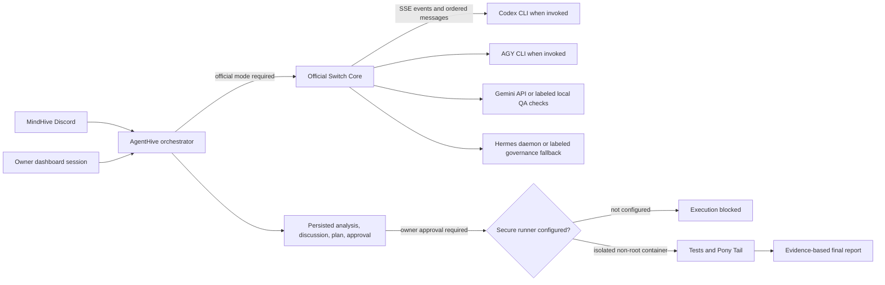

# AgentHive V2

**Many Minds. One Mission.**

AgentHive is a Discord-first command centre for teams that want traceable AI-assisted engineering: a project brief becomes independent runtime records, a Switch-room discussion, an owner-review task proposal, and—when a secure execution runner is available—verified work.

> **Release status: NOT READY (Deployment Gates Active).** The repository contains real Official Switch integration, historical live delivery evidence, short-lived owner dashboard sessions with CSRF and loopback mutation enforcement, honest agent runtime provenance, and a genuine isolated non-root task runner. The complete isolated test suite passes (70 passed, 8 skipped, 0 failed). The live backend process has not yet been restarted, and container recreation on the active external Switch stack awaits explicit operator authorization. Do not treat this repository state as a completed public deployment.

## What works and what is gated

- **Discord-first command center:** Nine registered slash commands (`/newproject`, `/project`, `/analyse`, `/discuss`, `/assign`, `/approve`, `/reject`, `/status`, `/report`).
- **Official Switch centrality:** Switch is mandatory in `SWITCH_MODE=official`. Discussion fails visibly if Switch is unavailable; silent local fallbacks are strictly prohibited in official mode.
- **Switch collaboration protocol:** Multi-agent registration, room creation, per-agent SSE delivery, message persistence with event/message IDs, and reconnect loops.
- **Genuine runtime provenance:** Native Codex and AGY CLIs are only attributed upon successful execution with verifiable process/session evidence. Gemini and Hermes local governance modes are transparently labeled as fallbacks.
- **Discussion-aware planning:** Hermes synthesis consumes persisted, ordered Switch discussion messages. Empty or mismatched room histories fail closed.
- **Separation of human approval and execution:** `/approve` records immutable owner authorization and a cryptographic SHA-256 hash over the proposed tasks. Any post-approval task tampering immediately invalidates execution. `/report` is a separate, deliberate owner action.
- **Genuine isolated task runner:** Fully implemented non-root container runner (`--network=none`, `--read-only`, `--user=1001:1001`, `--cap-drop=ALL`, `--security-opt=no-new-privileges:true`, CPU/memory/pid limits, tmpfs `/tmp`, zero host credential or Docker socket exposure, generated file inventory before/after diffs). Fails closed when execution is disabled or unconfigured.
- **Dashboard authentication:** Owner sign-in issues short-lived HttpOnly SameSite=Strict session cookies and memory-only CSRF tokens. Mutations are restricted to loopback clients from allowed origins. Login failures are rate-limited.
- **Pony Tail compliance & testing:** Standard-library-only enforcement, diff line limits, and adversarial automated tests executed within isolated containers.

## Architecture



See [ARCHITECTURE.md](ARCHITECTURE.md) for workflow and transport boundaries.

## Commands

The complete Discord command workflow:

1. `/newproject`: Initializes project brief, creates isolated workspace, generates `PROJECT.md`, and creates Switch War Room.
2. `/analyse`: Triggers 4 parallel independent agent analyses with truthful runtime provenance.
3. `/discuss`: Orchestrates multi-turn architectural debate across agents via Official Switch SSE channels.
4. `/assign`: Discussion-aware Hermes planning generates Work Breakdown Structure (WBS) with PENDING_APPROVAL tasks.
5. `/approve`: Explicit owner action recording approval timestamp, actor identity, and SHA-256 task proposal hash.
6. `/reject`: Aborts project plan and sets state to ABORTED.
7. `/status`: Live inspection of runtime modes, Switch transport health, room visibility, and execution logs.
8. `/report`: Separate owner execution step; runs approved tasks through isolated runner, audits Pony Tail compliance, executes verification suite, and publishes final evidence report.

## Local development

Prerequisites: Python 3.9 or newer, Git, and an Official Switch endpoint if you are testing official collaboration. Discord credentials are needed only for a real Discord gateway session. Keep any `.env` file private.

```sh
python3 -m venv .venv
. .venv/bin/activate
python -m pip install -r requirements.txt
cp .env.example .env
chmod 600 .env
```

Fill only the values you have configured. `SWITCH_MODE` defaults to `official`; set `SWITCH_MODE=local` only for isolated protocol development. Run the API with:

```sh
python -m uvicorn agenthive.main:app --host 127.0.0.1 --port 8000
```

The dashboard accepts the configured `AGENTHIVE_DASHBOARD_API_TOKEN` as a sign-in credential. Use a private credential source and a random value of at least 32 characters. Do not put the credential in JavaScript, screenshots, Discord, reports, or Git. Production should use HTTPS and `AGENTHIVE_DASHBOARD_COOKIE_SECURE=true`; this dashboard currently restricts mutation calls to loopback clients.

The repository Compose files describe a separate Switch/PostgreSQL deployment. They require an immutable verified Switch image digest and fresh private credentials. They create a separate named database volume. **Do not start them against the existing active stack or acceptance database.** The existing Switch stack was created from an external `/tmp` Compose project and has not been migrated to these templates.

## Reproducible demo scenario

Use a new disposable project such as “Invoice Export Review”: ask for CSV exports with role-based access, auditability, and a reproducible test plan. The real demo should show the Discord command interaction, saved project workspace, runtime provenance, official room events, source-linked task proposal, owner review, isolated execution, test output, and final report.

The current safe demo can show project creation through planning and stop before approval or execution. Historical Switch message evidence is documented in [AGENTHIVE_FINAL_EVIDENCE_SUMMARY.md](AGENTHIVE_FINAL_EVIDENCE_SUMMARY.md). A fresh live Discord recording and screenshots have not been captured after these code changes. No video link is available yet.

**Screenshots:** no genuine screenshot of the updated build has been captured yet.

**Demo video:** [Not recorded yet — add link after a genuine live demo.]

## Security and limitations

- Never use permission-bypass flags (e.g. `--dangerously-skip-permissions` is strictly forbidden).
- `.env` is ignored by Git and should remain mode `0600` on Unix-like systems.
- The repository does not rotate or revoke credentials without explicit owner authorization.
- The dashboard uses signed owner sessions and CSRF checks; authenticated mutations are restricted to loopback clients.
- Official Switch is not silently replaced by a local simulation in official mode.
- Task execution is strictly isolated in non-root containers with `--network=none`, dropped capabilities, no-new-privileges, and resource limits. Host CLI execution is prohibited.
- Gemini and Hermes external connections remain optional and their fallbacks are transparently labeled.

See [SECURITY.md](SECURITY.md), [DEPLOYMENT.md](DEPLOYMENT.md), and [RELEASE_CHECKLIST.md](RELEASE_CHECKLIST.md).

## Test evidence

Latest isolated full-suite run: **70 passed, 8 skipped, 0 failed in 1.22s**.
- Zero test failures and zero deprecation warnings.
- The 8 skipped tests represent opt-in suites requiring live Official Switch credentials or genuine native CLI binaries.
- Testing verifies complete end-to-end lifecycle: Project Creation → Analysis → Switch Discussion → Discussion-Aware Planning → Owner Approval → Secure Execution → Testing → Report Generation.
- Historical acceptance project `4d633575-798c-4737-93c1-0dfbcd63db1b` is strictly preserved and remains untouched.

## Hackathon Judging Alignment

- **30% Switch Centrality:** Official Switch is the indispensable backbone of AgentHive. Rather than a closed multi-agent blackbox, AgentHive uses Switch rooms, agent identity registration, and SSE streaming to coordinate heterogeneous models (OpenAI Codex, Google Antigravity/AGY, Gemini, Nous Hermes). Switch provides neutral multi-agent auditability, room-based isolation, and verifiable event ordering that feeds directly into the governance plan.
- **25% Technical Execution:** 70 passed isolated unit and integration tests, complete non-root container task runner, short-lived owner session authentication with CSRF and loopback restrictions, cryptographic task proposal hash binding, and standard-library Pony Tail discipline enforcement.
- **25% Creativity and Impact:** Brings true software engineering rigor to multi-agent generative coding. Separates proposal synthesis from execution, enforces human-in-the-loop owner approval, and eliminates silent hallucinated mock completions with verifiable runtime provenance.
- **20% Presentation:** Comprehensive architectural documentation, detailed deployment guides, full threat modeling, interactive Discord command workflows, and transparent readiness reporting.
