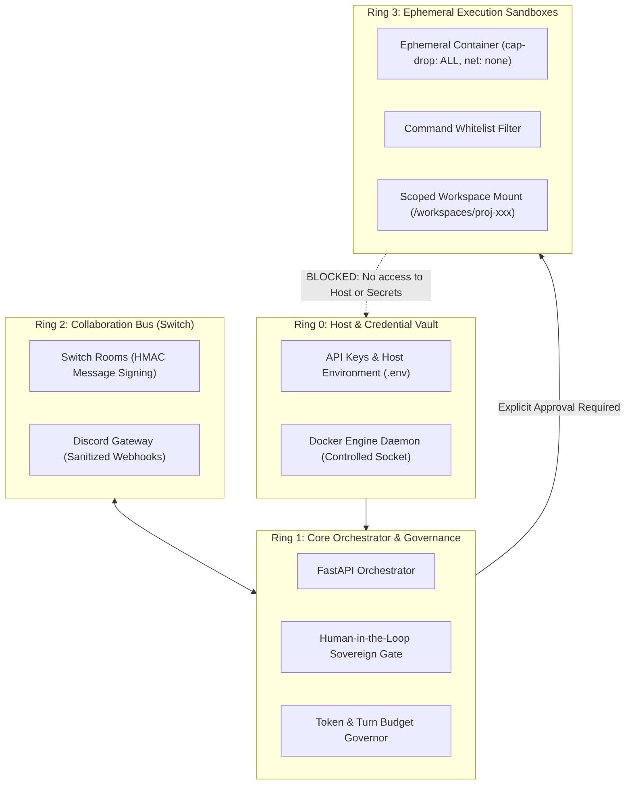

# AgentHive — Security & Reliability Architecture (`SECURITY.md`)

This document defines the defense-in-depth security model, sandboxing boundaries, credential governance, loop mitigation, and reliability controls protecting **AgentHive**.

---

## 1. Threat Model & Defense-in-Depth Architecture

Multi-agent autonomous systems introduce distinct security attack vectors: prompt injection, runaway resource consumption, unauthorized file access, remote code execution, and credential exfiltration.

AgentHive implements a multi-layered security ring:



---

## 2. Agent Isolation & CLI Hardening

No agent has unrestricted access to the host machine. Every CLI and runtime execution operates under strict sandboxing and workspace scoping:

### 2.1 AGY CLI (Antigravity) Hardening
- **Removal of Unrestricted Bypasses:** The flag `--dangerously-skip-permissions` is **completely banned** and removed from production adapters.
- **Native Terminal Restrictions:** AGY executes with `--sandbox` enabled at all times.
- **Granular Tool Permissions:** Instead of blanket auto-approvals, explicit granular permissions are passed per-session via `--settings`:
  ```json
  {"permissions": {"allow": ["command(python3)", "command(pytest)", "command(unittest)"]}}
  ```
- **Workspace Scoping:** AGY is strictly constrained to the individual project directory via `--add-dir <project_workspace>`, preventing file reads or writes outside the project.

### 2.2 Codex CLI (OpenAI) Hardening
- **Strict Sandbox Policy:** Native `codex exec` is executed with `-s workspace-write`, restricting all file creation, edits, and deletions strictly to the target workspace.
- **Working Root Confinement:** The root directory is bound via `-C <workspace_dir>`.
- **Zero Host Escape:** Commands attempting to access host locations (`/etc`, `/Users/sidh._./.ssh`, `/Library`) are blocked by the OS seatbelt sandbox.

### 2.3 Filesystem Path Traversal Protection
The orchestrator performs cryptographic canonical path resolution on every workspace directory before delegating to agents:
```python
ws_path = Path(proj.project_md_path).parent.resolve()
root_path = Path(settings.workspace_root).resolve()
if not str(ws_path).startswith(str(root_path)):
    raise PermissionError(f"Security Boundary Violation: Workspace {ws_path} is outside {root_path}")
```

---

## 3. Sandboxed Container Isolation (Docker)

All untrusted code execution and adversarial verification runs inside strictly hardened, ephemeral Docker containers:

```text
Docker Security Parameters:
├── network_mode: none             # Completely offline during execution (zero network exfiltration)
├── cap_drop: ["ALL"]              # Drop all Linux capabilities (no root privileges)
├── security_opt: ["no-new-privileges:true"] # Prevent privilege escalation
├── read_only: false               # Scoped to /app only
├── user: "1001:1001"              # Enforce non-root execution (agenthive user)
├── pids_limit: 100                # Prevent fork bombs
├── cpus: "1.5"                    # Prevent CPU starvation
└── mem_limit: "1024m"             # Hard 1GB RAM ceiling
```

- **Ephemeral Lifecycle:** Containers are created per task, executed, and immediately deleted (`--rm`).
- **Filesystem Confinement:** Only the designated project subdirectory is mounted.

---

## 4. Human-in-the-Loop Sovereign Approval Gate

AgentHive enforces a hard sovereign gate between planning and execution. Even if all 4 AI agents agree unanimously on a plan, **zero code executes** until the human Project Owner explicitly authorizes it via Discord or API:

```python
# Orchestrator Sovereign Approval Enforcement
if not approved_tasks:
    raise ValueError("No tasks approved for execution. Project Owner must approve first.")
```

- **Discord Interactive Buttons:** Projects present an interactive Discord action row with green "Approve & Run" and red "Reject" buttons.
- **Granular Task Control:** The user can approve the entire WBS plan or selectively authorize individual task codes (e.g. `/approve project_id TASK-01`).

---

## 5. Secret Governance & API Key Protection

1. **Zero Secret Exposure Policy:**
   - API keys (`OPENAI_API_KEY`, `GEMINI_API_KEY`, `DISCORD_BOT_TOKEN`, `SWITCH_API_KEY`) reside exclusively in memory or host environment variables managed by the root daemon.
   - **Never Written to Disk:** Keys are never written to `PROJECT.md`, task logs, audit trails, or Git repositories.
   - **Prompt Stripping:** Outgoing prompts dispatched to agents and messages posted to Discord channels are stripped of any secret tokens before broadcast.

---

## 6. Infinite Debate Mitigation & Reliability Governance

To guarantee that agent swarms never loop infinitely or exhaust token budgets:
1. **Turn Limits:** Every discussion round is hard-capped at `MAX_DISCUSSION_TURNS=6`.
2. **Floor Closure:** Hermes actively monitors agreement and closes the debate floor when consensus is reached.
3. **Bounded Timeouts:** Subprocess execution times out after 25–40 seconds with graceful fallback recovery.
