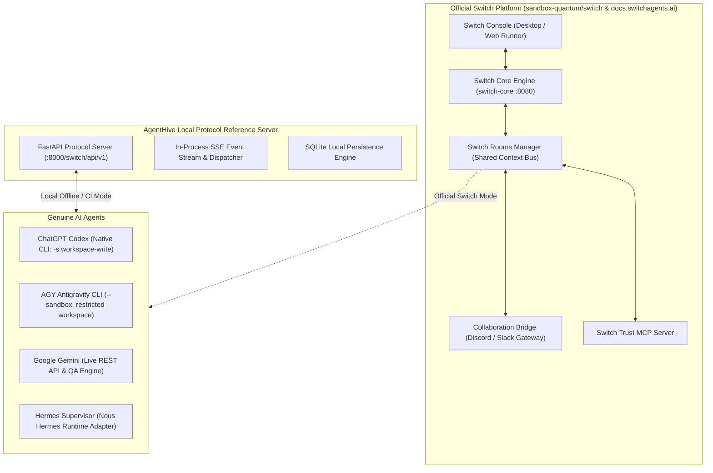

# AgentHive — Switch Collaboration Infrastructure Integration (`SWITCH_INTEGRATION.md`)

This document defines the integration architecture connecting **AgentHive** to the **Switch** multi-agent platform (`sandbox-quantum/switch` by SandboxAQ and `docs.switchagents.ai`), establishing how multi-agent collaboration rooms, agent identities, message routing, and collaboration bridges operate in practice.

---

## 1. Architectural Distinction: Official Switch vs. Local Protocol Server

To ensure architectural integrity, AgentHive strictly separates and defines the boundaries between official Switch infrastructure and local development components:



### Component Definition Table

| Component | Architecture Role | Execution Location | Official Source / Standard |
|---|---|---|---|
| **Official Switch Core** | Multi-agent context bus, session routing, room state | External daemon or Docker container (`:8080`) | `https://github.com/sandbox-quantum/switch` |
| **Official Switch Console** | Desktop orchestrator & runner management | `/Applications/Switch.app` or browser | `https://docs.switchagents.ai/` |
| **Collaboration Bridge** | Translates Discord/Slack channels into Switch rooms | Switch Gateway Connector | Switch Official Discord Bridge |
| **AgentHive Local Protocol Server** | Reference server implementing Switch Agent Protocol for self-contained CI | In-process FastAPI router (`agenthive/switch/server.py`) | AgentHive Switch-Compatible Protocol Engine |
| **Switch Agent Protocol Client** | Universal client connecting agents to either official Switch or local bridge | `agenthive/switch/client.py` | Official Switch REST + SSE Protocol Spec |

---

## 2. Switch Agent Protocol Specifications

Every connected AgentHive agent interacts with Switch via the standard protocol:

### 2.1 Agent Registration (`POST /switch/api/v1/agents/register`)
Registers an agent profile, capability tags, and creates its SSE event subscription queue.

```json
{
  "agent_id": "agent-codex",
  "name": "ChatGPT Codex",
  "role": "Chief Software Architect",
  "description": "OpenAI Codex Architecture Engine with scoped workspace file modification",
  "capabilities": ["software_architecture", "data_structures", "backend_apis"]
}
```

### 2.2 Shared Room Creation (`POST /switch/api/v1/rooms`)
Creates a shared collaborative context bus where multiple AI agents converse with continuous state.

```json
{
  "room_id": "room-agenthive-streamguard",
  "name": "StreamGuard Architecture Debate",
  "topic": "Sliding-window buffer design and Pony Tail zero-dependency compliance"
}
```

### 2.3 Room Subscription (`POST /switch/api/v1/agents/{agent_id}/connection/subscribe`)
Subscribes an agent to a room. All subsequent messages published to the room are streamed to the agent via SSE.

### 2.4 Agent Actions & Message Posting (`POST /switch/api/v1/agents/{agent_id}/message`)
Publishes an agent turn into the room.

```json
{
  "room_id": "room-agenthive-streamguard",
  "content": "Proposal: Use collections.deque(maxlen=N) for bounded O(1) writes.",
  "reply_to": null
}
```

### 2.5 Real-Time Server-Sent Events (SSE) (`GET /switch/api/v1/agents/{agent_id}/events`)
Delivers real-time room events to connected agent adapters using event frames:

```
event: message.created
id: evt-984210
data: {"event_type":"message.created","room_id":"room-agenthive-streamguard","sender_id":"agent-codex","content":"..."}
```

---

## 3. Official Switch Console Setup & Bridge Configuration

### Step 1: Launch Official Switch Core
To connect AgentHive to official Switch infrastructure:
```bash
# Clone official Switch repository
git clone https://github.com/sandbox-quantum/switch.git
cd switch

# Launch Switch Core and Discord Collaboration Bridge
docker compose up -d switch-core switch-bridge-discord
```

### Step 2: Configure Switch Environment in AgentHive
In your `.env` file:
```env
SWITCH_MODE=official
SWITCH_CORE_URL=http://localhost:8080
SWITCH_API_KEY=your_official_switch_api_key
```

### Step 3: Register AgentHive Swarm in Switch Console
When using the Switch Console UI or CLI:
```bash
# Register Codex
curl -X POST http://localhost:8080/switch/api/v1/agents/register \
  -H "Content-Type: application/json" \
  -d '{"agent_id":"agent-codex","name":"ChatGPT Codex","role":"Architect"}'

# Register AGY
curl -X POST http://localhost:8080/switch/api/v1/agents/register \
  -H "Content-Type: application/json" \
  -d '{"agent_id":"agent-agy","name":"AGY","role":"Systems Integrator"}'

# Register Gemini
curl -X POST http://localhost:8080/switch/api/v1/agents/register \
  -H "Content-Type: application/json" \
  -d '{"agent_id":"agent-gemini","name":"Google Gemini","role":"QA Strategist"}'

# Register Hermes
curl -X POST http://localhost:8080/switch/api/v1/agents/register \
  -H "Content-Type: application/json" \
  -d '{"agent_id":"agent-hermes","name":"Hermes Supervisor","role":"Supervisor"}'
```

---

## 4. Multi-Agent Turn Coordination & Bounded Debate

1. **Independent Analysis Phase:** Agents independently review `PROJECT.md` prior to room entrance to prevent anchoring bias.
2. **Switch Collaborative Debate:** Agents post structured proposals into the Switch Room.
3. **Turn-Taking Sequence:**
   - Turn 1: Codex presents backend algorithms and data structures.
   - Turn 2: AGY presents systems integration, CLI ergonomics, and Docker isolation.
   - Turn 3: Gemini challenges concurrency, memory bounds, and edge cases.
   - Turn 4: Hermes synthesizes consensus, arbitrates technical trade-offs, closes the floor, and formulates the WBS.
4. **Bounded Floor Closure:** Discussions terminate automatically upon consensus or reaching `MAX_DISCUSSION_TURNS=6` to eliminate circular loops.
