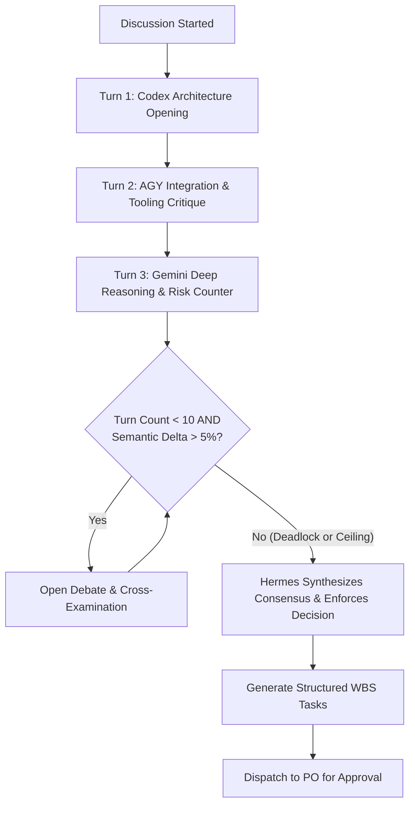

# AgentHive — System Design Specification (`SYSTEM_DESIGN.md`)

This document details the low-level technical architecture, API contracts, data models, event schemas, file system layouts, and concurrency controls powering **AgentHive**.

---

## 1. Event-Driven Architecture & Event Catalog

AgentHive operates on an internal asynchronous event bus. All state changes emit typed events processed by subscribers (Discord Gateway, Switch Bridge, Hermes Engine, and Sandbox Controller).

```mermaid
graph LR
    subgraph EventProducers["Event Producers"]
        D_In["Discord Gateway"]
        A_Adapters["Agent Adapters"]
        SB_Exec["Docker Sandbox"]
    end

    subgraph EventBus["AgentHive Event Bus (asyncio.Queue / Redis)"]
        Topics["Event Stream Channel"]
    end

    subgraph EventConsumers["Event Consumers"]
        SM["FSM Orchestrator"]
        Hermes["Hermes Supervisor"]
        DocSync["Git & PROJECT.md Sync"]
        DiscordOut["Discord Webhook Notifier"]
    end

    EventProducers -->|Publish Event| EventBus
    EventBus -->|Consume Event| EventConsumers
```



### 1.1 Canonical Event Catalog

| Event Name | Trigger Condition | Payload Summary | Primary Subscribers |
|---|---|---|---|
| `project.created` | PO executes `/agenthive create` in Discord | `project_id`, `name`, `raw_prompt`, `po_user_id` | Document Manager, Switch Bridge |
| `doc.generated` | Initial `PROJECT.md` created on disk | `project_id`, `file_path`, `git_commit_sha` | Agent Adapters (Trigger Analysis) |
| `analysis.completed` | Agent finishes private review of `PROJECT.md` | `project_id`, `agent_name`, `summary`, `risks` | FSM Orchestrator, Database Logger |
| `discussion.started` | All agents complete independent review | `project_id`, `switch_room_id`, `topic` | Switch Room, Discord Thread Notifier |
| `discussion.message` | Agent posts message in Switch room | `project_id`, `sender`, `reply_to`, `content` | Hermes Supervisor, Discord Thread |
| `conflict.detected` | Hermes identifies contradictory proposals | `project_id`, `conflict_type`, `parties`, `issue` | Discord Thread, Project Owner Escalation |
| `task.proposed` | Hermes synthesizes debate into WBS | `project_id`, `wbs_items[]`, `agent_allocations` | Discord Approval Gateway |
| `task.approved` | PO clicks "Approve" button on Discord | `project_id`, `po_user_id`, `approved_wbs_ids` | Sandbox Controller, Hermes |
| `task.started` | Ephemeral container initialized for task | `project_id`, `task_id`, `agent_name`, `container_id` | Discord Logs Channel, DB Logger |
| `task.completed` | Container completes execution & tests | `task_id`, `exit_code`, `diff_patch`, `test_results` | Hermes Supervisor, Git Sync |
| `project.summarized` | All tasks verified; final report compiled | `project_id`, `summary_md`, `total_tokens` | Discord Channel, PO Direct Message |

---

## 2. API Schemas & Data Contracts (Pydantic v2)

All API boundaries, webhook payloads, and inter-service communications enforce typed Pydantic models.

### 2.1 Project Creation & Status Models

```python
from pydantic import BaseModel, Field
from typing import List, Optional, Dict
from datetime import datetime
from uuid import UUID

class ProjectCreateRequest(BaseModel):
    name: str = Field(..., min_length=3, max_length=50, description="Slugified project name")
    description: str = Field(..., min_length=10, description="Project goals and requirements from PO")
    po_discord_id: str = Field(..., description="Discord snowflake ID of Project Owner")
    guild_id: str = Field(..., description="Discord Guild / Server ID")

class AgentAnalysisPayload(BaseModel):
    project_id: UUID
    agent_name: str
    proposed_architecture: str
    recommended_tech_stack: List[str]
    identified_risks: List[str]
    estimated_complexity: str = Field(..., regex="^(LOW|MEDIUM|HIGH|CRITICAL)$")
    review_notes: str

class WBSItem(BaseModel):
    task_id: str = Field(..., example="TASK-01")
    title: str
    description: str
    assigned_agent: str = Field(..., example="Codex")
    dependencies: List[str] = Field(default_factory=list)
    estimated_effort: str
    ponytail_constraints: List[str]

class TaskProposalPayload(BaseModel):
    project_id: UUID
    summary: str
    tasks: List[WBSItem]
    requires_external_packages: bool = False
    requested_packages: List[str] = Field(default_factory=list)
```

### 2.2 Switch Room Message Model

```python
class SwitchMessageEvent(BaseModel):
    room_id: str
    message_id: str
    sender_id: str
    sender_name: str
    sender_role: str = Field(..., regex="^(AGENT|SUPERVISOR|HUMAN_PO|SYSTEM)$")
    reply_to_message_id: Optional[str] = None
    content: str
    turn_index: int
    token_usage: Dict[str, int]
    timestamp: datetime = Field(default_factory=datetime.utcnow)
```

---

## 3. Discussion Room Protocol & Loop Prevention

To maintain productive engineering debates without runaway costs or circular reasoning, AgentHive enforces a formal **Debate Protocol**:



### 3.1 Turn Rules & Token Budgeting
- **Phase A (Opening Statements):** Turn 1–3 are sequentially assigned:
  1. Codex presents baseline architecture and backend components.
  2. AGY evaluates implementation simplicity and workspace diagnostics.
  3. Gemini challenges edge cases, performance bottlenecks, and testability.
- **Phase B (Peer Debate):** Turns 4–10 allow dynamic `@mentions` and replies between agents.
- **Circuit Breakers:**
  - **Max Conversation Turns:** 10 turns maximum per discussion round.
  - **Session Token Ceiling:** 100,000 total tokens across all models per discussion. If reached, the session is paused immediately and handed to Hermes for synthesis.
  - **Semantic Drift Detection:** If cosine similarity between consecutive rounds exceeds `0.92` (indicating repetitive argument with no new information), Hermes forcibly intervenes.

---

## 4. File System Hierarchy & Workspace Isolation

AgentHive maintains strict directory separation between persistent engine state, living documentation, and isolated agent execution workspaces:

```text
/Users/sidh._./AgentHive/
│
├── data/                                # Relational DB & audit logs
│   ├── agenthive.db                     # SQLite database (WAL enabled)
│   └── audit/                           # Tamper-proof JSONL audit logs
│       └── 2026-11-04-events.jsonl
│
├── workspaces/                          # Project work directories (Git tracked)
│   └── proj-8f92a1c0/                   # UUID or slugified project directory
│       ├── .git/                        # Dedicated Git repo per project
│       ├── PROJECT.md                   # Single source of truth spec
│       ├── docs/                        # Architectural notes & diagrams
│       │   ├── independent_reviews.md
│       │   └── meeting_minutes.md
│       ├── src/                         # Generated source code
│       ├── tests/                       # Generated test suites
│       └── output/                      # Scoped container mount point
│
└── sandboxes/                           # Ephemeral Docker workspace templates
    ├── Dockerfile.python-sandbox
    ├── Dockerfile.go-sandbox
    └── docker-compose.sandbox.yml
```

---

## 5. Relational Database Schema DDL (PostgreSQL & SQLite)

The database schema supports both SQLite (MVP) and PostgreSQL 16+ (Production) via SQLAlchemy:

```sql
-- Projects Table
CREATE TABLE projects (
    id VARCHAR(36) PRIMARY KEY,
    name VARCHAR(100) NOT NULL,
    discord_guild_id VARCHAR(32) NOT NULL,
    discord_channel_id VARCHAR(32) NOT NULL,
    discord_thread_id VARCHAR(32),
    switch_room_id VARCHAR(64),
    current_state VARCHAR(32) NOT NULL DEFAULT 'DRAFT',
    project_md_path VARCHAR(255) NOT NULL,
    created_at TIMESTAMP DEFAULT CURRENT_TIMESTAMP,
    updated_at TIMESTAMP DEFAULT CURRENT_TIMESTAMP
);

-- Agent Discussion Log Table
CREATE TABLE discussion_messages (
    id VARCHAR(36) PRIMARY KEY,
    project_id VARCHAR(36) REFERENCES projects(id) ON DELETE CASCADE,
    turn_number INTEGER NOT NULL,
    sender_agent VARCHAR(50) NOT NULL,
    role VARCHAR(20) NOT NULL,
    reply_to_agent VARCHAR(50),
    message_content TEXT NOT NULL,
    prompt_tokens INTEGER DEFAULT 0,
    completion_tokens INTEGER DEFAULT 0,
    created_at TIMESTAMP DEFAULT CURRENT_TIMESTAMP
);

-- Work Breakdown Tasks Table
CREATE TABLE tasks (
    id VARCHAR(36) PRIMARY KEY,
    project_id VARCHAR(36) REFERENCES projects(id) ON DELETE CASCADE,
    task_code VARCHAR(20) NOT NULL, -- e.g. TASK-01
    title VARCHAR(150) NOT NULL,
    description TEXT NOT NULL,
    assigned_agent VARCHAR(50) NOT NULL,
    status VARCHAR(30) NOT NULL DEFAULT 'PENDING_APPROVAL',
    human_approved BOOLEAN DEFAULT FALSE,
    branch_name VARCHAR(100),
    created_at TIMESTAMP DEFAULT CURRENT_TIMESTAMP,
    updated_at TIMESTAMP DEFAULT CURRENT_TIMESTAMP
);

-- Task Execution Logs Table
CREATE TABLE task_execution_logs (
    id VARCHAR(36) PRIMARY KEY,
    task_id VARCHAR(36) REFERENCES tasks(id) ON DELETE CASCADE,
    container_id VARCHAR(64),
    exit_code INTEGER,
    stdout TEXT,
    stderr TEXT,
    diff_patch TEXT,
    executed_at TIMESTAMP DEFAULT CURRENT_TIMESTAMP
);

-- Indexes for Query Performance
CREATE INDEX idx_projects_state ON projects(current_state);
CREATE INDEX idx_discussions_proj ON discussion_messages(project_id, turn_number);
CREATE INDEX idx_tasks_proj ON tasks(project_id, status);
```

---

## 6. Concurrency Control & File Access Management

Multi-agent systems can easily encounter race conditions when reading and updating documentation. AgentHive enforces strict access controls:

### 6.1 Documentation Read/Write Locking
- **Phase 2 (Analysis):** `PROJECT.md` is locked to **Read-Only**. Agents write analysis outputs to distinct private memory buffers without modifying the master file.
- **Phase 3 & 4 (Debate & Synthesis):** Only **Hermes** holds write locks on `PROJECT.md`. Hermes appends meeting notes and updates proposed WBS sections atomically.
- **Phase 6 (Execution):** Coding agents work on isolated Git feature branches (`feature/TASK-01-codex`). Merges to `main` require automated test passes and Hermes verification.

### 6.2 Optimistic Concurrency Control for Tasks
- Tasks stored in the database utilize version counters (`version_id`).
- When an agent claims or reports progress on a task, it passes the expected `version_id`. If another process modified the task state in the interim, the transaction aborts and retries.
