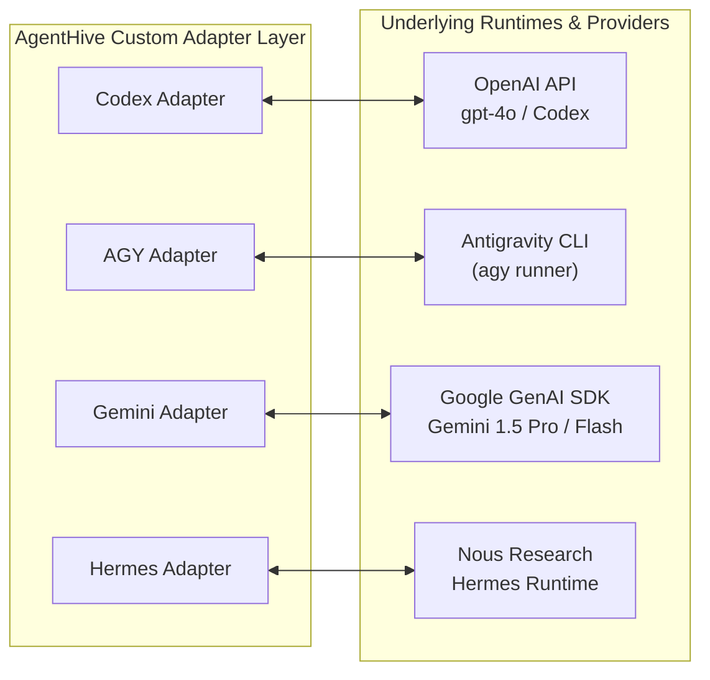

# AgentHive — Technical Stack & Engineering Rationale (`TECH.md`)

This document defines the technical stack, architectural trade-offs, and component selections for **AgentHive**. Every technology chosen is grounded in practical software engineering constraints, specifically optimized for a robust, hackathon-ready Minimum Viable Product (MVP) that seamlessly scales into enterprise production.

---

## 1. Executive Stack Overview

| Layer | Selected Technology | Alternative Considered | Primary Decision Driver |
|---|---|---|---|
| **Core Service Runtime** | Python 3.11+ / FastAPI | Node.js / Express, Go | Native AI/LLM SDK ecosystem, high-speed async I/O, Pydantic v2 data validation, OpenAPI autodoc. |
| **Agent Collaboration Engine** | Switch (`sandbox-quantum/switch`) | AutoGen, CrewAI, Raw WebSockets | Dedicated multi-agent room abstractions, native chat bridges, session management, MCP support. |
| **User Interface & Control Plane** | Discord API (Discord.py / Interactions) | Slack, Custom Web Dashboard | Zero-friction real-time collaboration, rich interactive UI (Embeds, Buttons, Modals), mobile/desktop availability. |
| **Supervising Agent Runtime** | Nous Research Hermes Agent CLI / Daemon | LangGraph Supervisor, Custom Rule Engine | Self-improving autonomous loop, persistent cross-session memory, multi-channel support, native tool gateway. |
| **Agent Adapters (Specialists)** | Custom Python Async Adapters (OpenAI, AGY, Gemini) | LangChain, LlamaIndex | Decoupled lightweight adapters, zero dependency bloat, granular token and rate-limit control. |
| **Project Knowledge Store** | Markdown (`PROJECT.md`) + Git | Pure SQL, MongoDB, Notion API | Git-versionable, human-readable, transparent diffs, universally parsable by all LLMs without schema conversions. |
| **Relational Data & State Store** | SQLite (Dev/Console) / PostgreSQL 16+ (Prod) | MongoDB, Redis-only | SQLite provides zero-config local pairing with Switch Console; PostgreSQL offers rock-solid ACID state management in production. |
| **Task Execution Sandbox** | Docker Engine & Docker Compose | Local `subprocess`, gVisor, Firecracker | Strong process and filesystem isolation, resource quotas, non-root user execution, ubiquitous developer availability. |
| **Engineering Discipline** | Pony Tail Skill (Dietrich Gebert) | Unrestricted Agent Prompts | Enforces strict YAGNI (You Aren't Gonna Need It), native standard libraries over package bloat, minimal diffs. |

---

## 2. Component Deep-Dive & Rationale

### 2.1 Core Orchestration Engine: Python 3.11+ & FastAPI

#### Why FastAPI?
- **Asynchronous Native Performance:** Multi-agent discussions involve concurrent I/O operations (streaming completions from OpenAI, Google GenAI, Antigravity CLI, and Switch WebSockets). FastAPI’s native `asyncio` foundation allows AgentHive to handle dozens of concurrent agent streams without thread exhaustion.
- **Pydantic v2 Data Modeling:** AgentHive relies on strict typed schemas for project specifications, agent messages, task definitions, and tool payloads. Pydantic v2 (implemented in Rust) guarantees microsecond validation and clean error feedback.
- **Automatic OpenAPI Documentation:** Facilitates immediate testing via `/docs` during the hackathon and provides a machine-readable schema for external MCP tools.
- **Background Tasks:** Allows non-blocking dispatch of long-running agent tasks while immediately acknowledging Discord webhook events.

#### Alternatives Considered:
- **Node.js / Express:** Strong WebSocket ecosystem, but weaker official integration with cutting-edge Python AI SDKs and local agent CLI tools (e.g. Antigravity and Hermes).
- **Go:** Blazing fast, but slower developer velocity during a hackathon and lacking native Python ecosystem bindings for certain agent tools.

---

### 2.2 Agent Collaboration Infrastructure: Switch (`sandbox-quantum/switch`)

#### What Switch Solves:
Switch (developed by SandboxAQ) acts as the collaborative fabric bridging humans and autonomous agents inside shared rooms:
1. **Room-Based Context Fabric:** Instead of managing isolated point-to-point chat threads, Switch creates persistent "Rooms" where multiple agents and human observers share a single conversation context and message history.
2. **Unified Message Bus:** Provides consistent identity tokens, avatars, and message routing regardless of the underlying agent backend (OpenAI, Gemini, local CLI).
3. **Switch Console Integration:** The local Switch Console (an Electron-based local orchestrator) manages local SQLite session states and agent provider configurations, allowing local agent processes to be triggered on-demand.
4. **Model Context Protocol (MCP) Support:** Switch natively integrates with MCP servers (such as Switch Trust), allowing agents to discover tools and query workspace security metrics safely.

#### Native vs. Custom Responsibilities:
- **Native Switch Components:** Shared room lifecycle, Discord bridge connectors, basic message routing, context persistence.
- **Custom AgentHive Adapters:** Bridging specific CLI wrappers (AGY, Hermes), intercepting project lifecycle events, orchestrating the 8-phase workflow, enforcing token budgets, and driving the Pony Tail skill.

---

### 2.3 User Interface: Discord

#### Why Discord?
- **Ubiquitous Developer Interface:** Engineering teams already live in Discord. It eliminates the need to build and maintain a complex custom frontend dashboard during the MVP phase.
- **Rich Component Model:** Discord provides interactive UI primitives:
  - **Slash Commands** (`/agenthive create`, `/agenthive status`, `/agenthive approve`) for structured user input.
  - **Action Rows & Buttons** (`Approve`, `Request Changes`, `Reject`) for instant human-in-the-loop governance.
  - **Modal Forms** for inputting detailed requirement revisions.
  - **Threads** for isolating project-specific agent debates without polluting main server channels.
- **Role-Based Access Control:** Discord’s native guild permissions ensure that only designated users (with the `Project Owner` or `Admin` role) can trigger sensitive approvals or project creations.

---

### 2.4 Supervising Agent: Nous Research Hermes Agent

#### Why Hermes?
- **Supervisory Autonomy:** Hermes is designed as an agent coordinator with advanced reasoning, reflective self-correction, and tool management capabilities.
- **Neutral Arbitration:** In multi-agent setups, frontier models from single vendors (e.g. OpenAI or Google) often carry inherent biases toward their own architectures. Hermes acts as an independent, neutral moderator to balance Codex and Gemini proposals.
- **Persistent Memory & Learning:** Hermes retains cross-session insights, remembering past architectural failures, team preferences, and Project Owner decisions.
- **Multi-Modal Frontends:** Operates via CLI (`hermes`), headless server daemon, or desktop GUI, making it easily embeddable into the AgentHive container network.

---

### 2.5 Agent Ecosystem & Custom Adapters

AgentHive integrates three distinct specialist agents alongside Hermes:



1. **ChatGPT Codex Adapter:**
   - **Role:** Chief Software Architect & Backend Implementer.
   - **Interface:** OpenAI Python SDK calling frontier models (`gpt-4o` / Codex specialized models) with structured JSON function calling.
2. **AGY (Antigravity) Adapter:**
   - **Role:** Independent Project Analysis & CLI Integration Specialist.
   - **Interface:** Headless wrapper invoking the `agy` CLI binary, utilizing native workspace awareness, codebase diagnostics, and local plugin tools.
3. **Google Gemini Adapter:**
   - **Role:** Deep Reasoning, Research, QA & Test Strategist.
   - **Interface:** `google-genai` SDK querying `gemini-1.5-pro` for expansive context analysis (up to 2M tokens) and `gemini-1.5-flash` for rapid feedback.
4. **Hermes Supervisor Adapter:**
   - **Role:** Moderator, Synthesizer, Task Allocator.
   - **Interface:** IPC / WebSocket connection to the local Hermes daemon or CLI subprocess, handling prompt injection of the supervision matrix.

---

### 2.6 Project Specification: Markdown (`PROJECT.md`)

#### Why Markdown-First?
- **Universal LLM Comprehension:** All frontier LLMs are heavily trained on Markdown. They parse, annotate, and update Markdown files natively with near-zero syntax errors compared to complex JSON or YAML schemas.
- **Git Native:** Every change made by an agent results in a clean, human-auditable Git diff.
- **Zero Lock-In:** The project owner can take `PROJECT.md` into any IDE, GitHub repository, or documentation tool without requiring proprietary viewer software.
- **Single Source of Truth:** Replaces disjointed database records with a single living document containing goals, constraints, agent assignments, and execution logs.

---

### 2.7 Storage & State Management: SQLite & PostgreSQL

#### Practical Dual-Engine Strategy:
1. **Local Development & MVP (SQLite):**
   - Paired directly with the Switch Console and local file system.
   - Zero-configuration, serverless, stored in `/AgentHive/data/agenthive.db`.
   - WAL (Write-Ahead Logging) mode enabled for safe concurrent reads by the FastAPI server.
2. **Production Enterprise (PostgreSQL 16+):**
   - Managed via SQLAlchemy ORM and Alembic migrations.
   - Stores session mappings, turn counters, rate limits, audit logs, and message vectors.
   - Decoupled from file storage; file contents remain strictly in Git workspaces.

---

### 2.8 Execution Sandboxes: Docker & Docker Compose

#### Why Container Sandboxing?
AI agents generating code must NEVER run untrusted commands directly on the host machine. Docker provides the optimal balance of isolation, performance, and portability:
- **Ephemeral Containers:** Each task execution runs in a freshly provisioned container that is destroyed upon task completion.
- **Security Hardening:**
  - `network_mode: none` during code execution (unless external package fetching is explicitly authorized by the Project Owner).
  - Dropped Linux capabilities (`cap-drop: ALL`).
  - Read-only root filesystem (`read_only: true`) with scoped write mounts to `/workspace/output`.
  - Non-root user (`user: 1000:1000`).
  - CPU and RAM limits (`cpus: 1.5`, `mem_limit: 1G`) to prevent runaway recursive code loops.

---

### 2.9 Code Discipline: Pony Tail Skill (Dietrich Gebert)

#### Why Pony Tail?
AI code generation commonly suffers from "eager over-engineering"—introducing 10 external npm/pip dependencies, complex design patterns, and excessive abstraction layers for simple problems.
**Pony Tail** introduces "the laziest senior developer in the room" into the prompt pipeline:
- Enforces strict adherence to the **7-Step Ladder of Laziness**:
  1. *Does this task even need code?* (YAGNI).
  2. *Can existing project functions solve this?*
  3. *Can native standard libraries (e.g. `pathlib`, `http.client`, `<dialog>`) solve this without external packages?*
  4. *What is the minimal correct diff that fulfills requirements?*
- Applied as a governance prompt injected into Codex and AGY, and monitored by Hermes during code review.

---

## 3. Technology Stack Matrix

```text
+-----------------------------------------------------------------------------------+
|                                 USER INTERFACE                                    |
|              Discord API (Discord.py / Interactions / Webhooks)                   |
+-----------------------------------------------------------------------------------+
                                         │  (WebSocket / Events)
                                         ▼
+-----------------------------------------------------------------------------------+
|                           COLLABORATION INFRASTRUCTURE                            |
|             Switch Platform (sandbox-quantum/switch) + Switch Console             |
+-----------------------------------------------------------------------------------+
                                         │  (Switch Event Bus / REST)
                                         ▼
+-----------------------------------------------------------------------------------+
|                                AGENTHIVE CORE                                     |
|    FastAPI (Python 3.11+) • Pydantic v2 • SQLAlchemy • AsyncIO Background Tasks   |
+-----------------------------------------------------------------------------------+
        │                     │                       │                      │
        ▼                     ▼                       ▼                      ▼
+---------------+     +---------------+       +---------------+      +---------------+
| Codex Adapter |     |  AGY Adapter  |       | Gemini Adapter|      | Hermes Engine |
|  (OpenAI SDK) |     |  (CLI Runner) |       | (GenAI SDK)   |      | (Nous Hermes) |
+---------------+     +---------------+       +---------------+      +---------------+
        │                     │                       │                      │
        └─────────────────────┼───────────────────────┴──────────────────────┘
                              ▼
+-----------------------------------------------------------------------------------+
|                         STORAGE & KNOWLEDGE PLANE                                 |
|     PROJECT.md (Git-Tracked)  •  SQLite / PostgreSQL (State & Audit Logs)         |
+-----------------------------------------------------------------------------------+
                              │
                              ▼
+-----------------------------------------------------------------------------------+
|                         EXECUTION & DISCIPLINE PLANE                              |
|   Docker Sandboxes (cap-drop, no-net)  •  Pony Tail Engine (YAGNI Laziness Ladder)|
+-----------------------------------------------------------------------------------+
```

---

## 4. Hardware & System Requirements

### Minimum Development Environment (Hackathon MVP):
- **OS:** macOS (Apple Silicon / Intel), Linux (Ubuntu 22.04+), or Windows with WSL2.
- **CPU:** 4 physical cores (8 threads recommended).
- **RAM:** 16 GB minimum (32 GB recommended if running local Hermes or Switch Console simultaneously).
- **Disk:** 10 GB free SSD space for Docker images, workspaces, and virtual environments.

### Production Deployment Target:
- **Host:** AWS EC2 `t4g.xlarge` / GCP `e2-standard-4` (ARM64 or x86_64).
- **Container Engine:** Docker Engine 24.0+ with Docker Compose v2.
- **Database:** Managed PostgreSQL (e.g. Supabase, AWS RDS, or self-hosted container).
- **Reverse Proxy:** Traefik or Nginx with TLS termination for secure Discord webhook callbacks.
