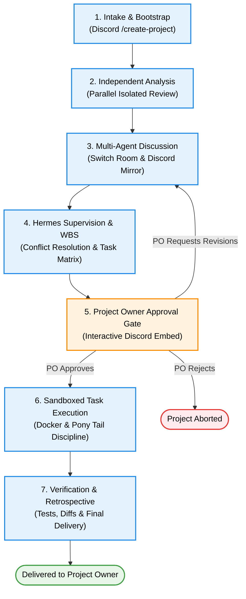
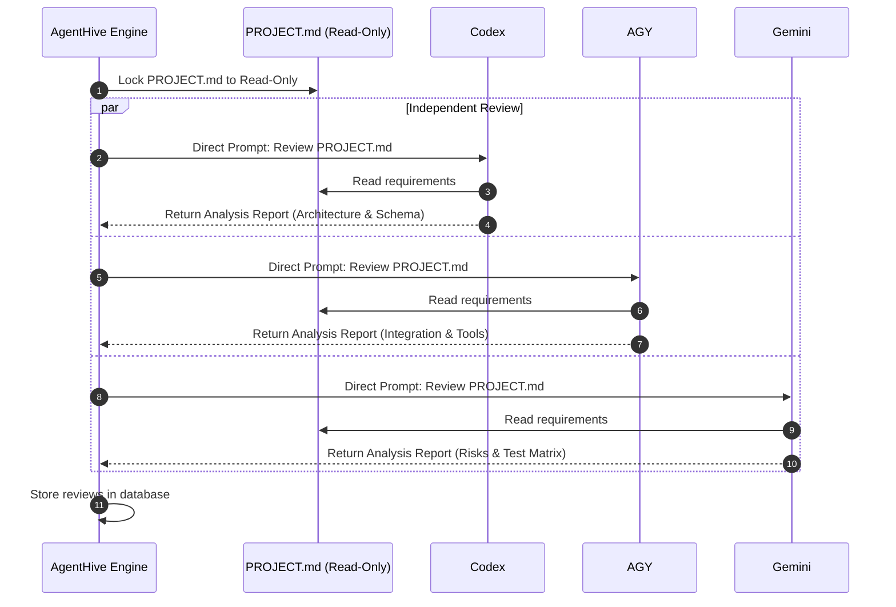
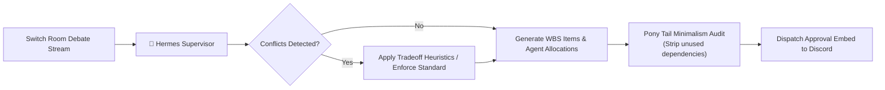

# AgentHive — End-to-End Operational Workflow (`WORKFLOW.md`)

This document details the step-by-step lifecycle of an **AgentHive** project, tracing the journey from the initial human prompt on Discord to the final delivery of tested, Git-committed code.

---

## 1. Lifecycle Overview Flowchart



---

## 2. Phase-by-Phase Operational Execution

---

### Phase 1: Intake & Bootstrap

**Actor:** Project Owner (Human) & AgentHive Discord Bot.

1. **User Action:** The Project Owner opens the designated `#agenthive-lounge` channel in Discord and invokes the slash command:
   ```text
   /agenthive create name: "LogStream" idea: "Build a high-performance in-memory log ingestion engine with structured tagging and regex querying in Python."
   ```
2. **Workspace Provisioning:**
   - AgentHive Core assigns a unique project UUID (e.g. `proj-8f92a1c0`).
   - A dedicated directory `/workspaces/proj-8f92a1c0` is provisioned.
   - A Git repository is initialized with an initial commit.
   - The master `PROJECT.md` file is generated from `PROJECT_TEMPLATE.md` with goals and constraints pre-populated.
3. **Collaboration Setup:**
   - A dedicated Discord thread `#project-logstream-war-room` is created.
   - A corresponding **Switch Room** (`room-logstream-8f92`) is registered in Switch Core.
   - The bot replies to the user with a confirmation embed containing links to the thread and workspace.

---

### Phase 2: Independent Agent Analysis

**Objective:** Prevent groupthink and model anchoring by evaluating requirements in parallel isolation.



1. **Zero-Peer Visibility:** Codex, AGY, and Gemini are triggered simultaneously via their private adapters. None of the agents can see the other agents' incoming reviews.
2. **Analysis Focus:**
   - **Codex:** Evaluates data structures, memory layouts, API contracts, and computational complexity.
   - **AGY:** Assesses CLI dependencies, OS compatibility, container overhead, and developer tooling.
   - **Gemini:** Scrutinizes missing edge cases, unbounded regex risks (ReDoS), memory leaks, and fuzz test vectors.
3. **Completion Gate:** Once all three analysis payloads are received and validated by the Pydantic schema, the engine transitions the project state to `IN_DISCUSSION`.

---

### Phase 3: Multi-Agent Switch Discussion & Peer Debate

**Objective:** Foster collaborative pressure-testing, challenge assumptions, and establish architectural consensus.

1. **Entering the Room:** All agents join the Switch Room `room-logstream-8f92`. Messages are mirrored in real time to the Discord war room thread.
2. **Turn 1 (Codex Opening):**
   > *"For LogStream, I propose a ring-buffer in memory with indexed inverted tags for $O(1)$ tag queries. Using native Python `collections.deque` with a fixed maxlen to guarantee bounded memory."*
3. **Turn 2 (AGY Tooling Check):**
   > *"Ring-buffer is clean. We can bundle this into a zero-dependency CLI using Python's standard library `argparse` and `sys.stdin`. No external pip packages needed."*
4. **Turn 3 (Gemini Challenge & Risk Analysis):**
   > *"I challenge the arbitrary regex search over deque items. If a user provides an unanchored regex with catastrophic backtracking (`(a+)+$`), the event loop will freeze. We must enforce a timeout or pre-compile with length limits. How will we verify memory bounds under sustained ingestion?"*
5. **Turn 4 (Codex Counter-Proposal):**
   > *"Good catch. We will compile regex patterns with `re.Scanner` and enforce a 50ms regex evaluation deadline. Gemini, will you formulate the test suite for pathological regex patterns?"*
6. **Turn 5 (Gemini Acceptance):**
   > *"Agreed. I will design the adversarial ReDoS test suite."*

---

### Phase 4: Hermes Supervision & Work Breakdown Structure (WBS)

**Objective:** Synthesize debate into an actionable, conflict-free task plan.



1. **Conflict Resolution:** If agents deadlock on an architectural choice, Hermes steps in with a definitive ruling based on project constraints (prioritizing native platform features and simplicity).
2. **Task Synthesis:** Hermes formulates the task matrix:
   - **`TASK-01 [Codex]`**: Core ring buffer and structured log model (`src/engine.py`).
   - **`TASK-02 [Codex]`**: Bounded regex query engine with timeout protection (`src/query.py`).
   - **`TASK-03 [AGY]`**: CLI ingestion interface & Docker sandbox harness (`src/cli.py`, `sandboxes/`).
   - **`TASK-04 [Gemini]`**: ReDoS adversarial tests and memory benchmark suite (`tests/test_stream.py`).
3. **Pony Tail Validation:** Hermes verifies that zero third-party packages were requested. The task matrix is audited and signed.

---

### Phase 5: Project Owner Review & Approval Gate

**Objective:** Enforce human sovereignty before any code is generated or executed.

```text
+-------------------------------------------------------------------------------+
|  🐝 AGENTHIVE — ARCHITECTURAL PLAN READY FOR APPROVAL                         |
|  Project: LogStream (ID: proj-8f92a1c0)                                       |
+-------------------------------------------------------------------------------+
|  The agent swarm has concluded architectural analysis and debate.            |
|                                                                               |
|  Summary of Architecture:                                                     |
|  • Zero-dependency Python in-memory ring buffer with structured tag index     |
|  • Bounded regex queries with 50ms evaluation deadline                        |
|                                                                               |
|  Proposed Work Breakdown Structure (WBS):                                      |
|  [TASK-01] Codex  -> Ring Buffer & Tag Store (src/engine.py)                  |
|  [TASK-02] Codex  -> Protected Regex Query Engine (src/query.py)              |
|  [TASK-03] AGY    -> CLI Ingestion Harness & Dockerfile (src/cli.py)          |
|  [TASK-04] Gemini -> ReDoS Test Matrix & Benchmarks (tests/test_stream.py)    |
|                                                                               |
|  Pony Tail Compliance: 100% Native Standard Library (0 pip packages)         |
+-------------------------------------------------------------------------------+
|  [  ✅ Approve & Execute  ]    [  ✏️ Request Changes  ]    [  ❌ Abort  ]      |
+-------------------------------------------------------------------------------+
```

- If the Project Owner clicks **`Approve & Execute`**, the orchestrator unlocks the execution pipeline.
- If the Project Owner clicks **`Request Changes`**, a modal opens allowing them to input feedback. Hermes re-opens the discussion with the PO's notes.
- If the Project Owner clicks **`Abort`**, the workspace is archived and execution stops.

---

### Phase 6: Sandboxed Execution & Task Delivery

**Objective:** Write code, run tests, and inspect diffs in isolated Docker containers.

```mermaid
sequenceDiagram
    autonumber
    participant H as Hermes
    participant Doc as Document Manager
    participant Box as Docker Sandbox (cap-drop: ALL)
    participant C as Codex / AGY
    participant T as Test Runner

    H->>Doc: Checkout feature branch feature/TASK-01-codex
    H->>Box: Spin up ephemeral container
    Box->>C: Execute Code Generation Prompt
    C-->>Box: Write src/engine.py
    Box->>T: Run pytest tests/
    T-->>Box: 12 passed, 0 failed in 0.42s
    Box-->>H: Report exit_code: 0 & diff patch
    H->>Doc: Commit and merge to main
```

1. **Isolation:** Ephemeral Docker containers mount `/workspaces/proj-8f92a1c0` with non-root permissions and disabled network access (`network_mode: none`).
2. **Pony Tail Enforcement:** If an agent attempts to invoke `pip install` or import unapproved packages, the execution is blocked and flagged to Hermes.
3. **Automated Verification:** The test runner executes Gemini's test suite inside the container.
4. **Self-Healing Loop:** If a test fails, the stderr and stack trace are fed back to the responsible agent for a maximum of 3 automated retry attempts.

---

### Phase 7: Verification, Progress Reporting & Final Summary

**Objective:** Deliver clean, tested code and comprehensive project documentation to the human user.

1. **Spec Finalization:** Hermes updates `PROJECT.md` with:
   - Final architecture decisions.
   - Completed WBS checklist.
   - Test execution metrics and code coverage.
   - Token expenditure and execution timeline.
2. **Git Release:** The workspace Git repo is tagged `v0.1.0`.
3. **Discord Delivery:** Hermes posts a final retrospective embed to Discord containing:
   - Links to completed files.
   - Quickstart commands for the Project Owner to run the code locally.
   - Executive retrospective detailing what was debated, challenged, and resolved.
